# LiveKit TURN 网络部署场景

- **日期：** 2026-10-22
- **文档类型：** 部署参考（仅文档）
- **范围：** `livekit-server` chart，LiveKit `v1.13.10`，coturn 4.14 sidecar
- **占位符：** 仅使用 RFC 5737 / RFC 1918 地址以及 `example.com` 域名

## 目的与范围

本文档介绍该 chart 能够产生的网络拓扑、每种拓扑所需的配置，以及浏览器、LiveKit SFU 与 TURN 服务器之间的端到端连接流程。本文面向部署该 chart 的运维人员和 SRE，帮助他们判断哪种拓扑适用于自己的环境，或诊断客户端为何能建立信令却无法发送媒体。

核心经验是：TURN 分配成功并不能证明浏览器可以连接。TURN 权限以**对端 IP**为键，因此 SFU 广播的地址与 SFU 实际发包使用的源地址必须一致。本文档中的大多数故障模式都源于这种不一致，而不是端口被阻断。

本文范围：

- 五种部署场景及各自的配置。
- TURN 权限机制，以及它们在 NAT 之后为何失败。
- 端口、安全组和负载均衡器映射。
- 使用现有连通性测试器进行验证。

不在本文范围：

- STUN/TURN 线协议内部细节和消息格式。
- LiveKit 应用 API、房间生命周期和编解码器行为。
- 多区域和 Redis 拓扑。
- IPv6。

## 术语与占位符

| 占位符 | 作用 |
|---|---|
| `lk.example.com` | 信令主机（ingress 或 NLB） |
| `turn.example.com` | 客户端拨号的 TURN 端点 |
| `203.0.113.10` | SFU 节点公网 EIP（NAT 模式） |
| `198.51.100.10` | 外部 coturn 公网 IP（场景 3） |
| `192.0.2.10` | 测试客户端公网反射地址 |
| `10.0.0.10` | 节点内网 IP（coturn 同节点部署） |
| `172.16.0.10` | 外部 coturn 内网 IP（场景 3） |
| `<turn-shared-secret>` | `coturn.secret` / `rtc.turn_servers[].secret` |

全文使用的术语：

- **信令（Signaling）：** 端口 7880 上到 `/rtc` 的 WSS 连接。它承载 JWT、`JoinResponse`、SDP 以及增量 ICE 候选。媒体从不通过信令传输。
- **SFU：** 终结 WebRTC 并转发媒体的 LiveKit 服务器。
- **候选类型：** `host`（端点自身的地址）、`srflx`（通过 STUN 发现的服务器反射地址）、`prflx`（从收到的数据包中学到的对端反射地址）、`relay`（在 TURN 服务器上分配的地址）。
- **TURN 分配（allocation）：** TURN 服务器为客户端预留的中继地址和端口。
- **TURN 权限：** `CreatePermission` 为某个**对端 IP 地址**安装一条允许规则。TURN 服务器会丢弃来自任何没有权限的源 IP 的流量，无论源端口是多少。
- **NAT 模式下的 EIP：** 由云网关拥有的公网地址，节点将其用于出站流量，通常带端口转换（SNAT/PAT）。该地址不在节点网卡上；除非存在 DNAT 规则、NLB 监听器或有状态的出站映射，否则没有入站映射。节点通常无法访问自己的 EIP；本文档称之为**无回环（no-hairpin）**特性。
- **打洞（Hole punching）：** 节点发送出站 UDP 时，NAT 网关会创建指向它的有状态映射。收到该数据包的对端会将映射后的地址学习为 `prflx` 候选，并可通过同一映射回复。这样无需静态 DNAT 规则即可直连媒体，但前提是 NAT 不使用对称映射或限制性过滤。ICE 一致性检查会在通话期间刷新该映射。
- **1:1 NAT：** 一个公网 IP 映射到一个内网 IP，并保持端口不变。coturn 的 `--external-ip=<public>/<private>` 正是为此设计。该映射是网络的属性；设置 `--external-ip` 并不会创建它。NAT 模式下的 EIP 不是 1:1 映射。
- **回环（Hairpin）：** 节点通过云网关访问自己的公网地址。NAT 模式 EIP 的部署通常无法可靠支持。

本文档中 NAT 映射出现的位置：

- **场景 2：** 节点的出站流量被 SNAT 到 NAT 网关地址；coturn **不**使用 `--external-ip=<public>/<private>`。中继保持在内网，SFU 广播其内部候选地址。直连媒体依赖打洞，而不是静态映射。
- **场景 3：** 外部 TURN 服务器使用 1:1 NAT 映射，工作正常。
- **场景 4：** 同节点部署的 coturn 配置了 coturn 的 1:1 NAT 形式（`--external-ip=<public>/<private>`），但公网地址是 NAT 模式 EIP，没有到节点的端口保持入站映射，也没有回环。它失败的原因是 SFU 无法通过自己的 EIP 访问中继。

如果公网地址是 NLB 或 NAT 网关地址，而不是绑定到节点的 EIP，同样的回环限制依然存在。

## LiveKit、ICE 与 TURN 如何协同工作

### 信令与媒体

浏览器打开 `wss://lk.example.com/rtc`，收到包含 TURN 服务器和短期 TURN 凭据的 `JoinResponse`，然后与 SFU 交换 ICE 候选。媒体使用选定的 ICE 候选对，而不是信令连接。

### SFU 的候选地址

LiveKit 从节点的网络接口推导 ICE 候选地址，然后可选地替换或添加地址：

- `rtc.use_external_ip: true` 通过 STUN 发现公网地址，并将其作为 host 候选广播。
- `rtc.advertise_internal_ip: true` 还会广播节点的内网地址。仅在设置了 `use_external_ip` 时有效。
- 当 `use_external_ip` 为 `false` 时，`rtc.node_ip` 设置一个显式地址。

要让广播的端口和 coturn sidecar 共享节点的网络命名空间，需要 `podHostNetwork: true`。

### 浏览器的候选地址与权限

浏览器收集自己的 host 候选，可能发现一个服务器反射地址，并从 TURN 获得一个中继候选。当使用中继候选时，浏览器会为 **SFU 广播的每一个远端候选 IP** 安装 TURN 权限，而不仅仅是最终胜出的那个候选对。

这就是场景 2 背后的关键行为。广播内部地址并非表面功夫：它会让浏览器在 TURN 上允许该地址。

### Chart 中 coturn 的接线方式

当 `coturn.enabled` 为 true 时，coturn 作为 sidecar 与 LiveKit 运行在同一 Pod 中，共享主机网络。Chart 的启动方式如下：

```text
turnserver -c /etc/coturn/turnserver.conf \
  --relay-ip=$NODE_IP --external-ip=$NODE_IP
```

或者，当设置了 `coturn.externalIP` 时：

```text
turnserver -c /etc/coturn/turnserver.conf \
  --relay-ip=$NODE_IP --external-ip=<coturn.externalIP>/$NODE_IP
```

`$NODE_IP` 来自 Pod 的 `status.hostIP`（节点内网 IP）。因此 chart 只能将 coturn 与 SFU 部署在同一节点；场景 3 需要在 `coturn.enabled: false` 的情况下单独部署一台 TURN 服务器。

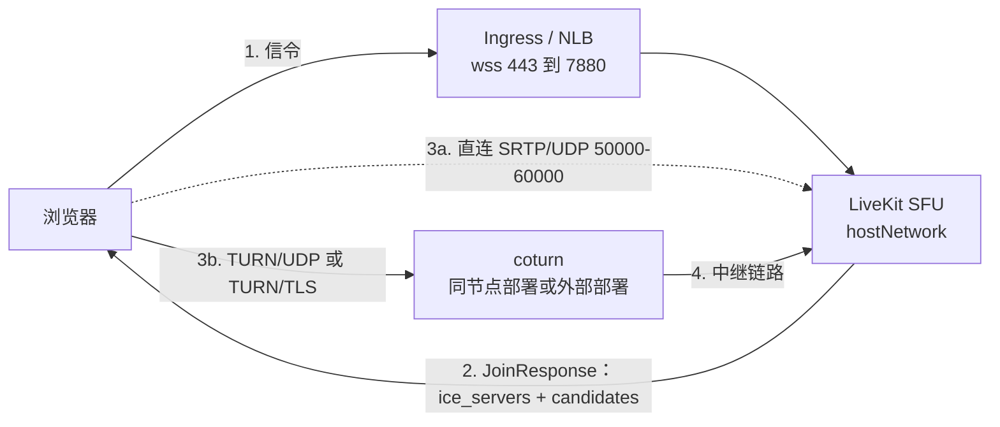

## 场景一览表

| # | 拓扑 | 何时使用 | TURN 中继 | 关键设置 |
|---|---|---|---|---|
| 1 | 公网 IP 直接位于节点上，coturn 同节点部署 | 节点网卡上带有公网地址 | 节点公网 IP | `use_external_ip: false`、`node_ip` |
| 2 | NAT 网关 EIP，coturn 同节点部署 | 节点出站被 SNAT 到 NAT 网关 EIP，且 TURN 运行在节点上 | 节点内网 IP | `advertise_internal_ip: true`、`coturn.externalIP: ""` |
| 3 | NAT 模式 EIP，外部 TURN 位于 1:1 NAT 之后 | TURN 必须部署在节点之外 | 公网 TURN IP | `coturn.enabled: false`、`rtc.turn_servers` |
| 4 | 同节点 coturn 在 NAT 模式 EIP 上声明 1:1 映射 | 不要使用；记录的是失败案例 | NAT 模式 EIP | `coturn.externalIP: <node EIP>` |
| 5 | TCP 上的 TURN/TLS 与 ICE/TCP | 客户端网络受限 | 继承场景 2 | `turns:` URL、`tcp_port` |

决策规则：

- 节点上有公网 IP：场景 1。
- NAT 网关 EIP 且 SFU 同节点：场景 2。
- TURN 必须在节点之外：场景 3。
- 同节点 coturn 把 NAT 模式 EIP 作为中继地址广播：避免（场景 4）。
- 客户端阻断 UDP：叠加场景 5。

## 场景 1 — 公网 IP 直接位于节点上，coturn 同节点部署

### 拓扑

节点的公网地址就在其网卡上。SFU、coturn 与互联网之间没有 NAT。直连和中继路径都是公网的。

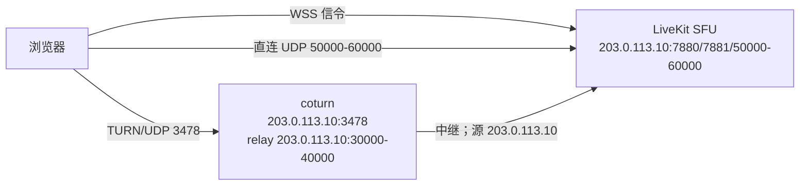

### 连接流程

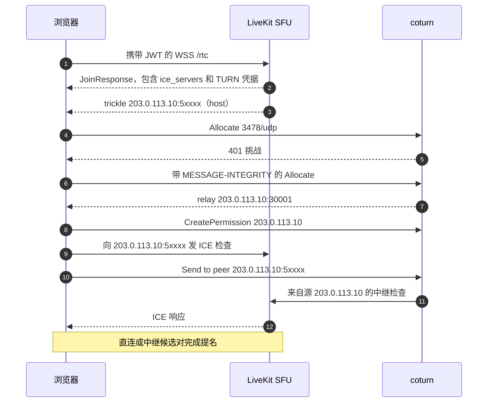

### 配置

```yaml
livekit:
  port: 7880
  rtc:
    tcp_port: 7881
    port_range_start: 50000
    port_range_end: 60000
    use_external_ip: false
    node_ip: 203.0.113.10
    advertise_internal_ip: false
    turn_servers:
      - host: turn.example.com
        port: 3478
        protocol: udp
        secret: <turn-shared-secret>
        ttl: 14400
  turn:
    enabled: false
coturn:
  enabled: true
  secret: <turn-shared-secret>
  realm: livekit
  listeningPort: 3478
  relayPortStart: 30000
  relayPortEnd: 40000
  externalIP: ""
  tls:
    enabled: false
podHostNetwork: true
turnLoadbalancer:
  enable: false
```

`use_external_ip: false` 加 `node_ip` 是确定性的；`use_external_ip` 为 true 时 `node_ip` 会被忽略，因此这两个设置要一起使用。这里设置 `use_external_ip: true` 并去掉 `node_ip` 也可以，因为 STUN 会发现同一个地址。

### 端口、安全组与负载均衡器

| 用途 | 端口/协议 | 位置 | 公网路径 |
|---|---|---|---|
| 信令 | 7880/tcp | SFU | ingress 或 NLB 443 |
| ICE/TCP | 7881/tcp | 节点 | 直连 |
| SFU 媒体 | 50000-60000/udp | 节点 | 直连 |
| TURN 监听 | 3478/udp | coturn | 直连或 NLB |
| TURN 中继 | 30000-40000/udp | coturn | 直连 |

安全组入站：TCP 7880、TCP 7881、UDP 50000-60000、UDP 3478、UDP 30000-40000。`lk.example.com` 和 `turn.example.com` 指向节点地址，或指向保留这些端口的 NLB。

### `test-livekit.py` 的预期输出

以下仅为示意；请在你自己的运行中记录实际输出的行。

```text
Phase 1: LiveKit signaling + discovery
   SFU advertised ICE candidates (from signaling):
     UDP 203.0.113.10:50001 (host)
Phase 2: STUN binding (server-reflexive address)
       reflexive : 192.0.2.10:53421   PASS
Phase 3: TURN relay over UDP
       allocate  : relay A 203.0.113.10:30001   relay B 203.0.113.10:30002   PASS
       relay data: token echoed via relay   PASS
Phase 4: TURN relay over TCP/TLS
   result         : SKIP  (no TCP/TLS TURN server advertised)
Phase 5: ICE connectivity checks (RFC 8445, relay-only)
       selected  : relay 203.0.113.10:30001  <->  relay 203.0.113.10:30002   PASS
```

在收到 SFU 候选地址的健康运行中，不会打印任何 `address :` 行。该行缺失即为通过信号。

### 症状 → 原因 → 修复

| 症状 | 原因 | 修复 |
|---|---|---|
| Phase 2 FAIL | UDP 3478 被阻断，或 coturn 未运行 | 开放安全组；查看 coturn 日志 |
| Phase 3 PASS 但客户端失败 | 中继端口范围 30000-40000 被阻断 | 开放 UDP 30000-40000 |
| Phase 1 没有候选地址行 | 信令或 ingress 有问题 | 检查 ingress 和 WSS URL |
| Phase 4 SKIP | 未广播 `turns:` URL | 未配置场景 5 时的预期行为 |

## 场景 2 — 节点位于 NAT 网关 EIP 之后，coturn 同节点部署，同时广播内部和外部候选

如果节点的出站地址是 NAT 网关 EIP，推荐使用此拓扑。

### 拓扑

节点使用内网地址（`10.0.0.10`）。出站流量被 NAT 网关 SNAT 为 `203.0.113.10`；该地址不在节点上，SFU 媒体端口范围也没有入站 DNAT 规则。coturn 在内网地址上中继。LiveKit 同时广播 STUN 发现的公网候选和 SFU 的内网候选。

即使没有 DNAT，直连仍可通过 ICE 打洞成功：SFU 是完整的 ICE agent，其出站检查会被 SNAT 并创建有状态映射；客户端把映射后的地址学习为对端反射（`prflx`）候选，并通过同一映射回复。这需要出站 UDP、`use_ice_lite: false`（默认值），以及允许入站检查的 NAT；对称 NAT、限制性过滤或阻断 UDP 的防火墙会使 TURN 成为唯一路径。

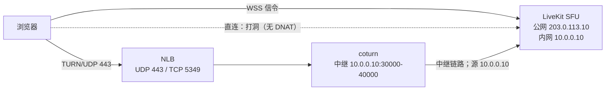

### 连接流程

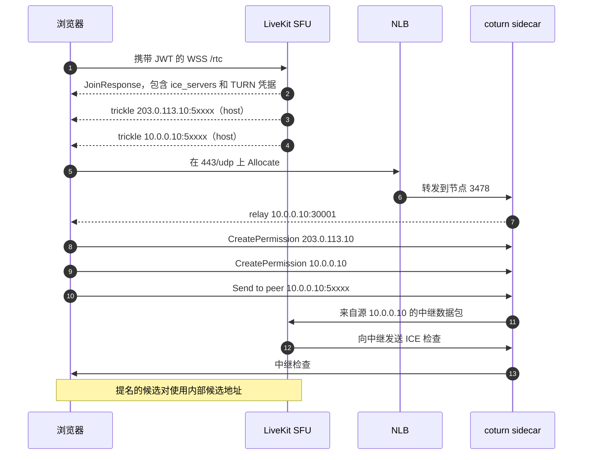

### 为什么不需要 EIP 回环

浏览器学到两个 SFU 候选，并为两个对端地址都安装 TURN 权限。coturn 的中继位于 `10.0.0.10`。SFU 到该中继的路由是本地路由，因此其源地址为 `10.0.0.10`；该源地址与为内部候选创建的权限匹配。

交给浏览器的中继候选是内网地址，但浏览器从不直接拨号它。浏览器通过自己的分配发送，由 TURN 服务器转发给对端。没有任何数据包需要从节点内部到达 `203.0.113.10`，而这正是 NAT 模式 EIP 无法做到的。

如果没有 `advertise_internal_ip`，浏览器只允许 `203.0.113.10`；SFU 的数据包来自 `10.0.0.10`，会被 coturn 丢弃。

直连路径也不需要回环。SFU 将检查出站发送到客户端的公网地址，NAT 网关对其做 SNAT，创建有状态映射。客户端回复到映射后的地址（`prflx`），网关再通过该映射把回复转发回来。广播的公网候选端口是节点的本地端口，而不是转换后的端口，因此广播的候选本身通常不可达；可用的是 `prflx` 地址。

### 配置

```yaml
livekit:
  port: 7880
  rtc:
    tcp_port: 7881
    port_range_start: 50000
    port_range_end: 60000
    use_external_ip: true
    advertise_internal_ip: true
    # 保持 false，让 SFU 发起检查以便打洞
    use_ice_lite: false
    turn_servers:
      - host: turn.example.com
        port: 443
        protocol: udp
        secret: <turn-shared-secret>
        ttl: 14400
      - host: turn.example.com
        port: 5349
        protocol: tls
        secret: <turn-shared-secret>
        ttl: 14400
  turn:
    enabled: false
coturn:
  enabled: true
  secret: <turn-shared-secret>
  realm: livekit
  listeningPort: 3478
  tlsPort: 5349
  relayPortStart: 30000
  relayPortEnd: 40000
  externalIP: ""
  tls:
    enabled: false
podHostNetwork: true
turnLoadbalancer:
  enable: false
```

`coturn.externalIP: ""` 会渲染为 `--external-ip=$NODE_IP`，因此中继保持在节点内网地址上。`coturn.tls.enabled: false` 是有意为之：NLB 终结 TLS，并将明文 TCP 转发到节点端口 3478。不要在 coturn 之外同时运行 LiveKit 内嵌的 TURN（`livekit.turn.enabled: false`）。

### 端口、安全组与负载均衡器

| 用途 | 公网 | 后端 | 协议 |
|---|---|---|---|
| TURN/UDP | `turn.example.com:443` | `10.0.0.10:3478` | UDP |
| TURN/TLS | `turn.example.com:5349` | `10.0.0.10:3478`（NLB 终结 TLS） | TCP |
| TURN 中继 | 无 | `10.0.0.10:30000-40000` | UDP |
| 信令 | `lk.example.com:443` | ingress 到 7880 | TCP |
| ICE/TCP | 无（无 DNAT） | `10.0.0.10:7881` | TCP |
| SFU 媒体 | 打洞映射 | `10.0.0.10:50000-60000` | UDP |

NAT 网关没有为媒体端口范围提供静态映射。UDP 直连媒体只有在 SFU 的出站检查创建有状态打孔、且客户端 NAT 允许入站检查时才能工作。广播的公网端口是节点的本地端口，而不是网关转换后的端口；实际端口是在选定候选对中看到的 `prflx` 端口。ICE/TCP 在这里没有等价的打洞路径：被动候选需要真正的入站映射。

中继端口范围仅在节点本地；对端只能通过 TURN 访问它，因此在此场景中不需要公网暴露。请为 coturn 自身保留节点防火墙上的开放。

### `test-livekit.py` 的预期输出

```text
Phase 1: LiveKit signaling + discovery
   SFU advertised ICE candidates (from signaling):
     UDP 203.0.113.10:50001 (host)
     UDP 10.0.0.10:50001 (host)
Phase 2: STUN binding (server-reflexive address)
       reflexive : 192.0.2.10:53421   PASS
Phase 3: TURN relay over UDP
       allocate  : relay A 10.0.0.10:30001   relay B 10.0.0.10:30002   PASS
       relay data: token echoed via relay   PASS
Phase 4: TURN relay over TCP/TLS
       allocate  : relay A 10.0.0.10:30003   relay B 10.0.0.10:30004   PASS
Phase 5: ICE connectivity checks (RFC 8445, relay-only)
       selected  : relay 10.0.0.10:30001  <->  relay 10.0.0.10:30002   PASS
Phase 6: Direct connectivity (no TURN)
   local          : host, srflx
   selected       : host 192.168.1.10:53421  <->  prflx 203.0.113.10:5yyyy
   result         : PASS
```

`prflx` 远端候选及其端口（与广播的候选不同）就是打洞后的映射。在对称或端口受限的客户端 NAT 上，Phase 6 可能失败，Phase 7 会选择中继。

不会打印 `address :` 行，因为 SFU 广播了内部候选（`server_has_private` 为 true）。退出码为 0。

当缺少 `advertise_internal_ip` 时，测试器会在选定候选对那一行之后打印以下之一：

```text
       address   : TURN relay 10.0.0.10 is private, SFU only advertises 203.0.113.10   FAIL
```

或者，当客户端的反射地址是公网地址时打印 `WARN`。`FAIL` 会使运行以非零码退出；`WARN` 不会。

### 症状 → 原因 → 修复

| 症状 | 原因 | 修复 |
|---|---|---|
| Phase 3/5 PASS，浏览器媒体失败 | 缺少 `advertise_internal_ip` | 设置 `livekit.rtc.advertise_internal_ip: true` |
| `address : ... FAIL` | 内网中继、仅公网 SFU、客户端位于 SNAT 之后 | 同上 |
| `address : ... WARN` | 同上，客户端有公网反射地址 | 同上；不要相信退出码 0 |
| 只出现公网候选 | 外部 IP 发现或 self-ping 失败 | 尝试 `skip_external_ip_validation: true` 或 `node_ip` |
| Phase 4 SSL 错误 | 证书不匹配 | 修复证书；`--insecure-tls` 仅用于测试 |
| Allocate 401/403 | coturn secret 与 `turn_servers[].secret` 不一致 | 使二者相等 |

## 场景 3 — 节点位于 NAT 模式 EIP 之后，外部 TURN 服务器位于 1:1 NAT 之后

当 TURN 必须运行在 SFU 节点之外时使用此场景。Chart 不部署该 TURN 服务器；`coturn.enabled` 保持 false，LiveKit 指向外部端点。

### 拓扑

外部 TURN 主机有一个公网地址（`198.51.100.10`），与其内网地址（`172.16.0.10`）1:1 映射。coturn 广播公网中继地址。SFU 到该中继的出站流量被 SNAT 为其自身的公网 EIP（`203.0.113.10`）。

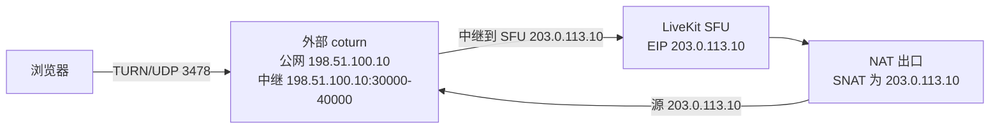

### 连接流程

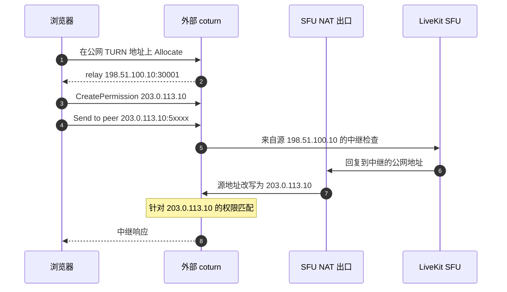

### 为什么权限能够匹配

浏览器允许的是 SFU 广播的公网 IP `203.0.113.10`。由于 SFU 与 TURN 服务器位于不同主机，SFU 发往公网中继的数据包离开节点后会被 SNAT 为 `203.0.113.10`。因此到达 coturn 的源地址与权限匹配。

权限以 IP 为键，而不是以源端口为键，因此 SFU 使用的临时端口无关紧要。如果 SFU 还广播了内部候选，浏览器也会允许 `10.0.0.10`；该权限对位于另一网络的 TURN 服务器毫无用处，但只要公网候选仍被广播就无害。

### 配置

Chart 侧：

```yaml
livekit:
  port: 7880
  rtc:
    tcp_port: 7881
    port_range_start: 50000
    port_range_end: 60000
    use_external_ip: true
    advertise_internal_ip: false
    turn_servers:
      - host: turn.example.com
        port: 3478
        protocol: udp
        secret: <turn-shared-secret>
        ttl: 14400
      - host: turn.example.com
        port: 5349
        protocol: tls
        secret: <turn-shared-secret>
        ttl: 14400
  turn:
    enabled: false
coturn:
  enabled: false
podHostNetwork: true
turnLoadbalancer:
  enable: false
```

外部 coturn 服务：

```bash
turnserver \
  --listening-port=3478 \
  --tls-listening-port=5349 \
  --relay-ip=172.16.0.10 \
  --external-ip=198.51.100.10/172.16.0.10 \
  --min-port=30000 --max-port=40000 \
  --use-auth-secret --static-auth-secret=<turn-shared-secret> \
  --realm=livekit \
  --cert=/etc/coturn/tls.crt --pkey=/etc/coturn/tls.key
```

### 端口、安全组与负载均衡器

在 TURN 主机上：入站 UDP 3478、TCP 5349、UDP 30000-40000。EIP 必须将这些端口 1:1 映射到内网地址。在 SFU 节点上：信令 7880、ICE/TCP 7881、UDP 50000-60000，与场景 2 相同。SFU 需要到 TURN 主机的出站访问。

### `test-livekit.py` 的预期输出

```text
Phase 1: LiveKit signaling + discovery
     TURN/UDP  turn:turn.example.com:3478?transport=udp
     TURN/TCP  turns:turn.example.com:5349?transport=tcp
   SFU advertised ICE candidates (from signaling):
     UDP 203.0.113.10:50001 (host)
Phase 3: TURN relay over UDP
       allocate  : relay A 198.51.100.10:30001   relay B 198.51.100.10:30002   PASS
Phase 5: ICE connectivity checks (RFC 8445, relay-only)
       selected  : relay 198.51.100.10:30001  <->  relay 198.51.100.10:30002   PASS
```

没有 `address :` 行。中继是公网的，因此地址不匹配检查不会触发。

Phase 3 和 Phase 5 不会检验 SFU 到 TURN 的链路。Phase 7 会把中继候选加入真实的客户端到 SFU 连接，因此当中继候选对成功时，它会检验该链路；直连胜出的运行不能证明中继路径。一次通过的运行加上上面的权限论证只是证据，不是证明；浏览器测试仍是最终检查。

### 症状 → 原因 → 修复

| 症状 | 原因 | 修复 |
|---|---|---|
| Allocate 401/403 | 共享 secret 不一致或 TTL 过期 | 使 secret 一致；检查时钟 |
| Phase 3 中继 PASS，SFU 检查被丢弃 | SFU 出站未被 SNAT 为其广播的 IP | 验证节点的出站路径和 EIP |
| 中继已分配但没有数据 | TURN EIP 上中继端口范围不可达 | 1:1 开放 UDP 30000-40000 |
| Phase 4 TLS 失败 | 证书或端口映射问题 | 检查 5349 和证书 SAN |

## 场景 4 — 反模式：同节点部署的 coturn 在 NAT 模式 EIP 上广播公网中继地址

此配置把 coturn 的 1:1 NAT 形式（`--external-ip=<public>/<private>`）用于一个公网地址是 NAT 模式 EIP 的节点。它纸面上看起来合理，也能通过连通性测试器，但浏览器无法发送媒体。记录此配置是为了便于识别并避免。

### 拓扑

`coturn.externalIP: 203.0.113.10` 会渲染为 `--external-ip=203.0.113.10/$NODE_IP`，因此 coturn 广播 `203.0.113.10` 作为中继地址，并假定网络将该地址以端口保持方式 1:1 映射到 `$NODE_IP`。NAT 模式 EIP 不提供这种映射：地址位于云网关上，中继端口范围 `30000-40000` 没有到节点的文档化入站映射，且节点无法回环到自己的 EIP。SFU 在同一节点上，必须向广播的地址发送 ICE 检查；这些检查永远到不了 coturn。即使回环可用，coturn 也可能看到 SFU 的内网源地址（`10.0.0.10`），而浏览器从未允许该地址。

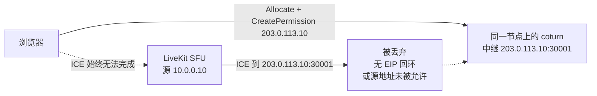

### 连接流程

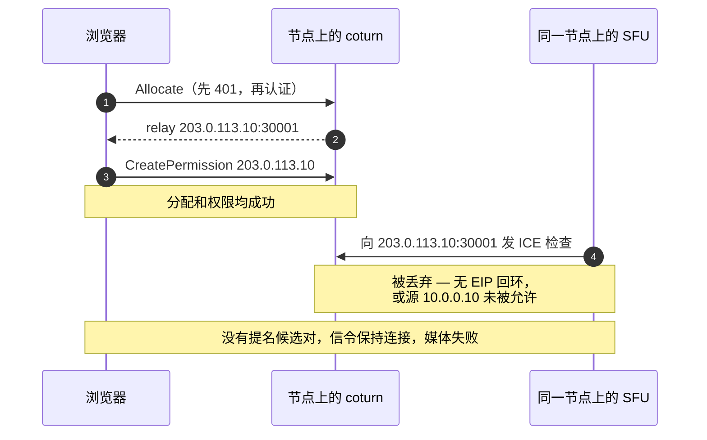

### 为什么失败

配置声明了 1:1 映射；部署并未提供。由此产生两种独立的机制：

1. **声明的映射不存在。** EIP 处于 NAT 模式：它位于云网关上，而不是节点网卡上，中继端口范围 `30000-40000` 没有到 `$NODE_IP` 的端口保持入站路径。coturn 因为 `--external-ip` 的指示而广播 `203.0.113.10`，但发往该地址的数据包并不会到达中继。节点无法回环到自己的 EIP，因此 SFU 的 ICE 检查被丢弃。
2. **权限源地址不匹配。** 即使存在回环或 DNAT 规则，coturn 也可能观察到 SFU 的源地址为 `10.0.0.10`。浏览器允许的是 `203.0.113.10`，因此 coturn 丢弃该检查。

任一机制都足以破坏媒体。

### 为什么仅中继测试无法发现它

测试器的 Phase 3 和 Phase 5 在同一 coturn 上使用两个分配。coturn 在本地转发分配之间的流量，因此中继到中继无需经过 EIP 就能通过。由于中继地址是公网的，`_relay_address_mismatch()` 永远不会触发；它要求内网中继加上仅公网的 SFU 候选。该运行在浏览器无法发送媒体的部署上以 0 退出。

Phase 7 确实向 SFU 提供了 TURN 候选，因此它会尝试 SFU 到中继的链路。但同一客户端也提供直连候选，而在此反模式中直连通常成功。因此 Phase 7 会以直连的最佳成功候选对报告 PASS，而中继路径已经损坏；当直连可用时，它不会因中继候选对失败而失败。

这是本文档中最重要的警告：**测试器绿灯不等于浏览器测试通过。**

### 产生该配置的配置方式

```yaml
livekit:
  rtc:
    use_external_ip: true
    advertise_internal_ip: false
    turn_servers:
      - host: turn.example.com
        port: 443
        protocol: udp
        secret: <turn-shared-secret>
coturn:
  enabled: true
  secret: <turn-shared-secret>
  externalIP: 203.0.113.10
  relayPortStart: 30000
  relayPortEnd: 40000
  tls:
    enabled: false
podHostNetwork: true
```

渲染后的 coturn 参数：

```text
turnserver -c /etc/coturn/turnserver.conf \
  --relay-ip=$NODE_IP --external-ip=203.0.113.10/$NODE_IP
```

`<public>/<private>` 形式是 coturn 的 1:1 NAT 模式：coturn 广播公网地址，并期望网络保持端口不变。只有当公网地址确实以端口保持方式 1:1 映射到 `$NODE_IP` 时才正确；同节点部署的 coturn 还需要回环，才能让其自己的 SFU 访问中继。场景 3 中的外部 TURN 主机满足 1:1 要求，因为它不与 SFU 同节点部署。场景 4 的 NAT 模式 EIP 两条都不满足。

### `test-livekit.py` 的预期输出

```text
Phase 3: TURN relay over UDP
       allocate  : relay A 203.0.113.10:30001   relay B 203.0.113.10:30002   PASS
       relay data: token echoed via relay   PASS
Phase 5: ICE connectivity checks (RFC 8445, relay-only)
       selected  : relay 203.0.113.10:30001  <->  relay 203.0.113.10:30002   PASS
```

没有 `address :` 行，退出码 0。浏览器侧的证据则不同：ICE 到达 `checking` 后变为 `failed`；coturn 日志显示有分配但没有对端流量；节点没有到自身 EIP 的流。

### 症状 → 原因 → 修复

| 症状 | 原因 | 修复 |
|---|---|---|
| 测试器 PASS，浏览器媒体失败 | 同节点 coturn 广播公网中继 | `coturn.externalIP: ""` 加 `advertise_internal_ip: true` |
| 在另一家云上可用，在这家云上失败 | 那家云支持 EIP 回环 | 不要依赖回环 |
| 从节点测试可用，从客户端失败 | 节点本地测试绕过了云网关 | 从外部浏览器测试 |

## 场景 5 — 基于 TCP 的 TURN/TLS 与 ICE/TCP 回退

此场景为无法发送 UDP 的客户端增加基于 TCP 的路径。它不是独立的 NAT 拓扑；它叠加在场景 2（或场景 3）之上。

### 拓扑

提供 TURN/TLS 有两种方式，另有一条独立的 ICE/TCP 路径。

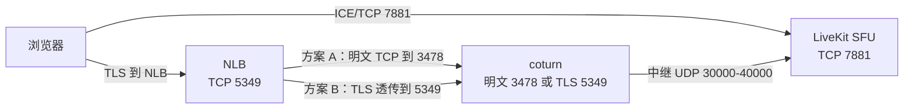

### 连接流程

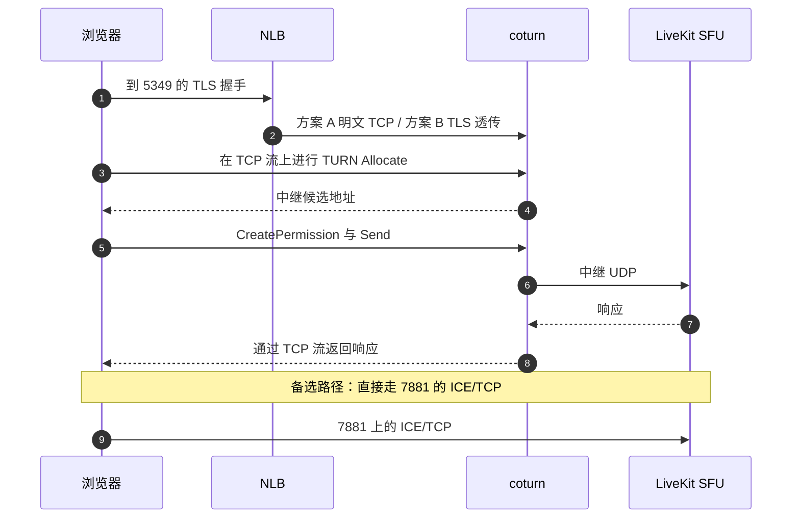

### 配置 — TLS 在 NLB 终结

```yaml
coturn:
  enabled: true
  listeningPort: 3478
  tls:
    enabled: false
livekit:
  rtc:
    tcp_port: 7881
    turn_servers:
      - host: turn.example.com
        port: 5349
        protocol: tls
        secret: <turn-shared-secret>
```

`coturn.tls.enabled: false` 使 coturn 配置输出 `no-tls` 和 `no-dtls`。coturn 在 3478 上提供明文 TCP。NLB 持有证书，并将明文 TCP 转发到节点 3478。

### 配置 — 由 coturn 终结 TLS

```yaml
coturn:
  enabled: true
  tlsPort: 5349
  tls:
    enabled: true
  tlsSecretName: <tls-secret>
livekit:
  rtc:
    tcp_port: 7881
    turn_servers:
      - host: turn.example.com
        port: 5349
        protocol: tls
        secret: <turn-shared-secret>
```

NLB 对节点 5349 做 TCP 透传。客户端仍然拨号公网端口（本例中为 5349），而不是直接拨号 5349。

当 `coturn.tls.enabled: true` 时，若 `coturn.tlsSecretName` 为空则回退到 `livekit.turn.secretName`。如果两者都为空，渲染出的 volume 无效。

### 端口、安全组与负载均衡器

| 用途 | 端口/协议 | 位置 | 公网路径 |
|---|---|---|---|
| TURN/TLS（NLB 终结） | 5349/tcp | NLB | 公网 |
| TURN 后端 | 3478/tcp | coturn | NLB 目标 |
| TURN/TLS（coturn 终结） | 5349/tcp | coturn | NLB 透传目标 |
| ICE/TCP | 7881/tcp | SFU | 需要 NLB 监听器；NAT 之后需要 DNAT |
| TURN 中继 | 30000-40000/udp | coturn | 同基础场景 |

如果同时启用了 TURN/UDP，保留场景 2 中的监听器和中继规则。

### `test-livekit.py` 的预期输出

```text
Phase 1: LiveKit signaling + discovery
     TURN/UDP  turn:turn.example.com:443?transport=udp
     TURN/TCP  turns:turn.example.com:5349?transport=tcp
Phase 4: TURN relay over TCP/TLS
       allocate  : relay A 10.0.0.10:30003   relay B 10.0.0.10:30004   PASS
       relay data: token echoed via relay   PASS
Phase 5: ICE connectivity checks (RFC 8445, relay-only)
       selected  : relay 10.0.0.10:30003  <->  relay 10.0.0.10:30004   PASS
```

使用自签名证书时，除非传入 `--insecure-tls`，Phase 4 会因 `ssl.SSLError` 失败。脚本不会测试 7881 上的 ICE/TCP；请用浏览器或真实通话单独验证。

### 症状 → 原因 → 修复

| 症状 | 原因 | 修复 |
|---|---|---|
| Phase 4 超时 | 发现的 URL 缺少 `transport=tcp` | 检查 `turns:` URL 形式和 NLB 目标 |
| Phase 4 SSL 错误 | 证书 SAN 或信任问题 | 修复证书；`--insecure-tls` 仅用于测试 |
| TLS 握手失败 | NLB 透传指向了 3478 而不是 5349 | 修正目标端口 |
| ICE/TCP 失败 | TCP 7881 被阻断 | 开放安全组和相应的 NLB 监听器 |

## 配置矩阵

### Helm values

| 场景 | `use_external_ip` | `advertise_internal_ip` | `coturn.enabled` | `coturn.externalIP` | `coturn.tls.enabled` | `rtc.turn_servers` | `turnLoadbalancer.enable` |
|---|---|---|---|---|---|---|---|
| 1 | false | false | true | `""` | false | udp 3478 | false |
| 2 | true | **true** | true | `""` | false | udp 443, tls 5349 | false |
| 3 | true | false | false | 不适用 | 不适用 | udp 3478, tls 5349 | false |
| 4 | true | false | true | 节点 EIP | false | udp 443 | false |
| 5 | 继承 2 | 继承 2 | true | `""` | false（A）/ true（B） | udp 443, tls 5349 | false |

### 基础设施

| 场景 | 公网地址模型 | NLB 监听器 | 安全组入站 | 备注 |
|---|---|---|---|---|
| 1 | 节点上的公网 IP | 可选 | 7880/tcp, 7881/tcp, 50000-60000/udp, 3478/udp, 30000-40000/udp | 无 NAT |
| 2 | NAT 网关 EIP（SNAT/PAT） | UDP 443 到 3478，TCP 5349 到 3478 | 443/udp 或 3478/udp, 5349/tcp；媒体无入站映射 | 中继保持内网；直连靠打洞 |
| 3 | SFU EIP 加 TURN EIP | TURN 主机上可选 | TURN 主机上 3478/udp, 5349/tcp, 30000-40000/udp | TURN 部署在节点之外 |
| 4 | NAT 模式 EIP | UDP 443 到 3478 | 与场景 2 相同 | 不要使用 |
| 5 | 继承 2 或 3 | 增加 TCP 5349 | 增加 TCP 5349、5349、7881/tcp | UDP 受限客户端 |

## 为什么 TURN 权限很重要

TURN 权限是针对**对端 IP 地址**的规则。浏览器为 SFU 广播的每个远端候选地址调用 `CreatePermission`。TURN 服务器随后接受来自这些源 IP 的流量，并丢弃其他所有流量，无论源端口是什么。

不变式：

> **TURN 服务器看到的 SFU 源 IP 必须是 SFU 向浏览器广播的对端 IP 之一。**

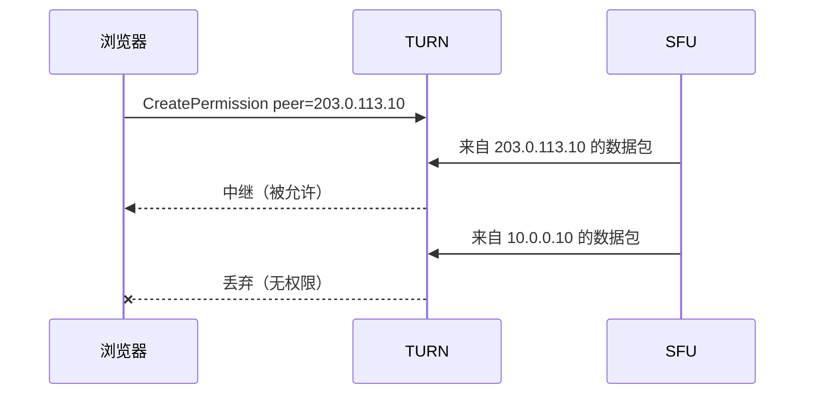

测试器的地址检查反映了这一不变式：

- 当 TURN 给出内网中继、而 SFU 只广播公网候选，**并且**客户端自身的反射地址是内网地址（客户端路径上存在 SNAT 的迹象）时，报 `FAIL`。运行以非零码退出。
- 同样的地址模式，但客户端反射地址为公网时，报 `WARN`。运行退出码为 0；该警告仍意味着仅中继客户端可能失败。
- 当 SFU 广播了内网候选，或未观察到任何 SFU 候选时，不打印 `address :` 行。

`WARN` 不会改变退出码，因此绿色运行并不能证明所有客户端路径都可用。

## 端口与防火墙矩阵

| 用途 | 端口/协议 | 所在位置 | 公网暴露 |
|---|---|---|---|
| 信令（WSS） | 7880/tcp | SFU | ingress 或 NLB 443 |
| ICE/TCP | 7881/tcp | SFU 节点 | 场景 1 直连；NAT 之后需要 DNAT/NLB 映射 |
| SFU 媒体 | 50000-60000/udp | SFU 节点 | 场景 1 直连；场景 2 打洞或中继 |
| TURN 监听 | 3478/udp 和 3478/tcp | coturn | NLB UDP 443、TCP 5349 |
| TURN/TLS | 5349/tcp | coturn | NLB TCP 5349（透传） |
| TURN 中继 | 30000-40000/udp | coturn | 仅在配置公网中继时需要 |

`podHostNetwork: true` 加固定端口意味着每个节点只能运行一个 LiveKit Pod。coturn 中继端口范围不得与 SFU 媒体端口范围重叠。

## 使用 run-test-livekit.sh 验证部署

在 `livekit-server/chart/scripts` 下运行：

```bash
ENV_FILE=/secure/livekit.env ./run-test-livekit.sh --timeout 8 -v
ENV_FILE=/secure/livekit.env ./run-test-livekit.sh --insecure-tls
```

env 文件以 `set -a` 方式被 source。它必须定义 `LIVEKIT_URL`、`LIVEKIT_API_KEY` 和 `LIVEKIT_API_SECRET`。切勿提交该 env 文件。

`run-test-livekit.sh` 还会安装可选的 Phase 8 工具：Python 的 `playwright` 包和固定版本的 `livekit-client` 浏览器 bundle。它使用已安装的 Google Chrome（`channel="chrome"`），因此不会下载浏览器。如果 Playwright、Chrome 或 bundle 不可用，Phase 8 会报告 `SKIP`；其余测试套件仍会运行。

参数：

| 参数 | 含义 |
|---|---|
| `--url`、`--api-key`、`--api-secret` | 覆盖环境变量 |
| `--room`、`--identity` | 房间和参与者身份 |
| `--protocol` | LiveKit 信令协议版本（默认 15） |
| `--timeout` | 每个操作的超时秒数（默认 5；ICE 有更高的下限） |
| `--insecure-tls` | 对 TURN/TLS 跳过证书验证 |
| `-v` | 打印 TURN 凭据详情和 aioice 日志 |

`--protocol` 适用于原始协议阶段。Phase 8 让浏览器 SDK 使用自己的协议，不受 `--protocol` 影响。

各阶段解读：

| 阶段 | 能证明 | 不能证明 |
|---|---|---|
| 1 信令 + 发现 | WSS 可用；TURN 服务器和 SFU 候选被广播 | 媒体连通性 |
| 2 STUN 绑定 | UDP 能到达 TURN 主机；显示客户端反射地址 | TURN 认证 |
| 3 TURN UDP 中继 | 认证分配、权限和数据中继 | SFU 到 TURN 的链路 |
| 4 TURN TCP/TLS 中继 | 在 TLS 流上完成同样的事 | 7881 上的 ICE/TCP |
| 5 仅中继 ICE | 真实 ICE agent 完成中继到中继并提名候选对 | 浏览器媒体、直连 ICE、SFU 源地址匹配 |
| 6 直连 | 真实 WebRTC 客户端在不配置 TURN 的情况下与 SFU 完成 ICE 和 DTLS | 媒体流；浏览器的路径选择 |
| 7 路径选择 | 一个真实 WebRTC 客户端提供 host、srflx 和 relay 候选，并报告提名候选对和优先级最高的成功候选对 | 媒体流；浏览器的独立选择（提名遵循控制方 ICE 角色）；直连也可用时的仅中继选择 |
| 8 浏览器路径 | 真实 Chrome/livekit-client 浏览器加入、发布合成轨道，并为每个浏览器 PeerConnection 报告选定候选对和 ICE 角色 | 仅中继行为（测试不强制 `iceTransportPolicy: "relay"`）；选定路径是否最优 |

Phase 6 和 Phase 7 使用 `aiortc` 作为真实 WebRTC 客户端应答 SFU 的订阅方 offer。`run-test-livekit.sh` 会安装它；如果缺失，这两个阶段都报告 `SKIP`。Phase 6 仅配置 STUN。Phase 7 配置 STUN 以及每个被广播的 TURN 端点及其短期凭据。当部署未广播 `stun:` URL 时，两者都只使用 TURN 主机做 STUN Binding；Phase 6 从不分配中继。

SFU 发送订阅方 offer，因此除非协商 ICE-lite，它是控制方 ICE agent。在 chart 默认值（`use_ice_lite: false`）下，SFU 控制并提名；测试客户端被控制。如果 SFU 是 ICE-lite，角色反转，由客户端控制。对于不支持 ICE-lite 的客户端（例如不支持 peer-reflexive-over-relay 的 Firefox），LiveKit 也可以强制使用完整 ICE。

Phase 8 是浏览器检查。它通过 Playwright 驱动已安装的 Chrome 和官方 `livekit-client` SDK，加入房间，发布一个合成的 canvas 轨道，并为浏览器创建的每个 PeerConnection 报告选定候选对和 ICE 角色。使用 SDK 默认的单 PeerConnection 模式，因此测试的行为与当前 Web 客户端一致；如果 SDK 创建了两个连接，两者都会报告。该阶段没有网络位置模式：它打印观察到的路径（直连或中继）、候选类型和地址，以及是否使用了内网地址。中继路径或内网地址是事实，不是失败。

```text
Phase 6: Direct connectivity (no TURN)
   local          : host, srflx
   selected       : srflx 192.0.2.10:53421  <->  host 203.0.113.10:50001
   result         : PASS
Phase 7: Path selection (direct vs TURN)
   local          : host, relay, srflx
   role           : SFU controlling (client controlled)
   nominated      : relay 10.0.0.10:30001  <->  host 10.0.0.10:50001   (relay)
   best successful: srflx 192.0.2.10:53421  <->  host 203.0.113.10:50001   (direct)
   note           : the controlling agent nominates; a relay pair can win before a
                    higher-priority direct pair completes.
   result         : PASS
Phase 8: Browser path (Chrome + livekit-client)
   client         : Chrome 155.0.8059.85 / livekit-client 2.23.0 (local)
   signaling      : wss://lk.example.com/rtc/v1 (join_request)
   peer connection: 1 (publisher+subscriber)
   gathered       : host, relay, srflx
   single         : direct  local srflx 192.0.2.10:53421  remote prflx <hidden>:35519  role=client/controlling
                    pair state=succeeded nominated=True ice=connected dtls=connected
                    inferred       : remote prflx 203.0.113.10 (from the SFU's public candidates; port 35519)
   private addr   : none
   result         : PASS
```

Chrome 可能会隐去远端对端反射候选和本地 host 候选的地址（`<hidden>`）；类型和端口仍会报告。当远端 `prflx` 地址被隐去时，Phase 8 会打印一行 `inferred`，其中列出 Phase 1 发现的 SFU 公网候选地址。这是推断，不是浏览器报告的值，端口是浏览器报告的端口。`gathered` 行是在选定候选对和短暂稳定之后拍摄的快照，因此稍后才完成的中继分配可能不会出现。

退出码：

| 码 | 含义 |
|---|---|
| 0 | 所有尝试的阶段都通过；SKIP 和 WARN 不算失败 |
| 1 | 至少一个尝试的阶段失败 |
| 2 | 缺少必需配置 |
| 3 | 缺少 Python 依赖 |

解读规则：

- `SKIP` 表示部署未广播该传输方式，或该阶段的可选依赖缺失。它不等于通过。
- 没有 `address :` 行意味着未检测到不匹配。它本身不能证明 SFU 到 TURN 的链路；Phase 7 只有在候选对成功时才会检验该链路。
- `WARN` 是潜伏的浏览器故障；不要把退出码 0 当作完整证明。
- 在 Phase 7 中，`nominated` 是控制方 agent 选定的候选对。完整 ICE 下由 SFU 发送订阅方 offer 并控制；ICE-lite 下由客户端控制。`best successful` 是连接后一秒稳定期内客户端优先级最高的成功候选对，因此连接后很快完成的检查也会被包含。它不一定是提名候选对，且仅在两者不同时打印。所测试的 LiveKit 版本未启用 Pion 的重新提名，因此中继提名不会被稍后的直连成功替换。
- 若需仅中继保障，请用 `iceTransportPolicy: "relay"` 运行浏览器并确认 ICE 达到 `connected`。Phase 7 提供中继候选，但也提供直连候选；直连最佳成功候选对不能证明中继路径。
- 在 Phase 8 中，`single`、`publisher` 和 `subscriber` 标记浏览器创建的 PeerConnection 或连接。`role=client/controlling` 表示浏览器提名；`role=SFU/controlled` 表示 SFU 提名。`direct`/`relay`、候选类型和地址、`private addr` 都是观察结果；中继路径或内网地址不会使该阶段失败。只有缺少成功的候选对、PeerConnection 断开或 ICE 角色无法读取才会失败。
- 当 Chrome 隐藏远端 `prflx` 地址时，`inferred` 行列出了 Phase 1 发现的 SFU 公网候选地址。请将其视为推断；可见端口是浏览器报告的端口。如果未发现任何 SFU 公网地址，则省略该行。
- Phase 8 使用 SDK 默认的单 PeerConnection 模式，因此反映的是当前浏览器客户端。它没有网络位置模式或预期路径开关；在哪里运行浏览器就在哪里运行它。`SKIP` 表示 Playwright、Chrome 或固定版本的 `livekit-client` bundle 不可用，而不是部署失败。
- 浏览器直连选择不能证明中继路径，中继选择也不能证明直连路径。Phase 8 报告默认策略下的选择；仅中继保障仍需要以 `iceTransportPolicy: "relay"` 运行浏览器。

## 跨场景的症状 → 原因 → 修复

| 症状 | 可能原因 | 修复 |
|---|---|---|
| Phase 1 失败 | DNS、ingress 证书、URL 错误、API key 无效 | 检查 `lk.example.com`、ingress 和凭据 |
| Phase 1 只显示公网候选 | 外部 IP 发现或 self-ping 失败 | 设置 `skip_external_ip_validation: true` 或 `node_ip` |
| Phase 1 没有候选地址行 | 信令完成但没有收到 trickle | 检查服务端版本和候选收集窗口 |
| Phase 2 FAIL | 到 TURN 主机的 UDP 被阻断，或 coturn 未运行 | 检查 NLB 监听器、安全组、coturn 日志 |
| Allocate 401/403 | `coturn.secret` 与 `rtc.turn_servers[].secret` 不一致 | 使二者完全相同 |
| Phase 3/4 PASS，浏览器媒体失败 | 同节点 coturn 把 NAT 模式 EIP 作为中继广播（场景 4） | `coturn.externalIP: ""` 加 `advertise_internal_ip: true`，或将 TURN 移出节点 |
| `address : ... FAIL` | 内网中继、仅公网 SFU、客户端位于 SNAT 之后 | 广播内部候选 |
| `address : ... WARN` | 同样的模式，客户端为公网 | 同样的修复；不要忽略 |
| Phase 3 中继已分配但没有数据 | 中继端口范围被阻断或未映射 | 端到端开放 UDP 30000-40000 |
| Phase 4 SSL 错误 | 自签名证书或证书错误 | 修复证书；`--insecure-tls` 仅用于测试 |
| Phase 4 超时 | 发现的 URL 缺少 `transport=tcp` | 检查 URL 形式和 NLB 目标 |
| ICE/TCP 失败 | TCP 7881 被阻断 | 开放 TCP 7881 |
| 测试器 PASS，仅中继浏览器失败 | SFU 源 IP 与允许的候选不匹配 | 使广播地址与源地址一致 |
| 从节点测试可用，从客户端失败 | 节点本地测试绕过了云网关 | 从外部浏览器测试 |

## 阿里云说明

这些说明适用于阿里云 EIP 和 NLB，但其推理可推广到行为相同的其他云。

- **NAT 模式下的 EIP。** EIP 位于公网网关，而不是 ECS 网卡上。实例只能看到自己的内网 IP。不要依赖节点访问自己的 EIP；EIP 回环不是可靠的基础构件。
- **打洞。** 使用 NAT 网关 EIP 且无入站 DNAT 时，只要 SFU 发起连通性检查且 NAT 允许该映射，直连媒体仍可工作。可用的远端地址是 `prflx` 地址，而不是广播的候选地址。不要把一次通过的直连测试当作对所有客户端网络都成立的证明；对称或端口受限 NAT 仍需要 TURN。
- **NLB 源 IP 保留。** TURN 服务器看到的是客户端公网地址还是内网 SNAT 地址，取决于 NLB 服务器组的后端类型和客户端 IP 保留设置。这会影响 `reflexive` 行，测试器用它来选择 `FAIL` 还是 `WARN`；它不改变 SFU 到 TURN 的权限逻辑。
- **EIP 绑定。** 确认 SFU 广播的地址是绑定到 ECS/ENI 的 EIP 还是 NLB 地址。如果是 NLB 地址，对这些端口使用 NLB 监听器；如果是节点 EIP，将端口 1:1 映射并使用安全组。
- **安全组。** 仅开放文档中列出的范围。将 coturn 中继范围与 SFU 媒体范围分开。
- **每个节点一个 Pod。** `hostNetwork` 和固定端口使得一个节点上不能运行两个 LiveKit Pod。请相应规划滚动更新和自动扩缩容。
- **中继端口范围。** coturn 使用 `relayPortStart`/`relayPortEnd`（默认 30000-40000）。SFU 媒体范围（50000-60000）与此无关；不要将其复用于 coturn。

## 待解决问题、已知不一致之处与风险

1. Phase 3 和 Phase 5 不会观察 SFU 到 TURN 的链路。Phase 7 会尝试，但当直连候选对获胜且中继路径已损坏时，它不会使运行失败。Phase 8 报告默认策略下的浏览器路径，因此能显示浏览器是否需要 TURN，但不强制仅中继。场景 4 仍可能通过所有阶段并以 0 退出，而仅中继浏览器失败；仍需要以 `iceTransportPolicy: "relay"` 运行浏览器。
2. `WARN` 不会使运行失败。绿色退出码仍可能意味着仅中继客户端失败。
3. `coturn.tls.enabled` 在 chart 中默认 `true`，但当 NLB 终结 TLS 时应设为 `false`。在没有 NLB 透传的情况下照搬 chart 默认值会破坏 TURN/TLS。
4. 当 `coturn.tls.enabled: true` 时，`coturn.tlsSecretName` 会在没有必需校验的情况下回退到 `livekit.turn.secretName`。如果两者都为空，渲染出的 volume 无效。
5. `advertise_internal_ip` 需要 `use_external_ip: true`。
6. 在使用外部 TURN 服务器的同时广播内部候选，可能产生 TURN 服务器无法使用的权限。请保持公网候选被广播，或在该拓扑中禁用内部广播。
7. 某些 coturn 构建会限制私有对端地址。场景 2 依赖到 `10.0.0.10` 的中继流量；如果该构建拒绝 RFC 1918 对端，中继链路将失败。请在部署的 coturn 版本上验证。
8. 长通话依赖 NLB 空闲超时和 TURN 分配刷新。示例中的凭据使用 `ttl: 14400`；请按部署情况调整。
9. 这些场景和测试器均未覆盖 IPv6。
10. chart 文件中的行号会漂移。评审时请使用值路径而不是行号引用。

## 源文件

- `livekit-server/chart/values.yaml`
- `livekit-server/chart/templates/deployment.yaml`
- `livekit-server/chart/templates/coturn-configmap.yaml`
- `livekit-server/chart/config-sample.yaml`
- `livekit-server/chart/scripts/test-livekit.py`
- `livekit-server/chart/scripts/run-test-livekit.sh`
- `livekit-server/chart/scripts/test_direct_connect.py`
- `livekit-server/chart/scripts/test_browser_phase.py`
- `livekit-server/chart/scripts/browser/`（页面和固定版本的 `livekit-client` bundle）
