# LiveKit TURN Network Deployment Scenarios

- **Date:** 2026-10-22
- **Document type:** deployment reference (documentation only)
- **Scope:** `livekit-server` chart, LiveKit `v1.13.10`, coturn 4.14 sidecar
- **Placeholders:** RFC 5737 / RFC 1918 addresses and `example.com` names only

## Purpose and scope

This document describes the network topologies the chart can produce, the
configuration required for each, and the end-to-end connection sequence between
a browser, the LiveKit SFU, and a TURN server. It is written for operators and
SREs who deploy the chart and need to decide which topology applies to their
environment, or diagnose why clients can signal but cannot send media.

The central lesson is that a successful TURN allocation does not prove a
browser can connect. TURN permissions are keyed by **peer IP**, so the address
the SFU advertises and the address the SFU actually sends from must agree. Most
of the failure modes in this document come from that mismatch, not from a
blocked port.

In scope:

- Five deployment scenarios and the configuration for each.
- TURN permission mechanics and why they fail behind NAT.
- Ports, security groups, and load-balancer mappings.
- Verification with the existing connectivity tester.

Out of scope:

- STUN/TURN wire-protocol internals and message formats.
- LiveKit application APIs, room lifecycle, and codec behavior.
- Multi-region and Redis topology.
- IPv6.

## Terminology and placeholders

| Placeholder | Role |
|---|---|
| `lk.example.com` | signaling host (ingress or NLB) |
| `turn.example.com` | TURN endpoint clients dial |
| `203.0.113.10` | SFU node public EIP (NAT mode) |
| `198.51.100.10` | external coturn public IP (Scenario 3) |
| `192.0.2.10` | test client public reflexive address |
| `10.0.0.10` | node private IP (co-located coturn) |
| `172.16.0.10` | external coturn private IP (Scenario 3) |
| `<turn-shared-secret>` | `coturn.secret` / `rtc.turn_servers[].secret` |

Terms used throughout:

- **Signaling:** the WSS connection to `/rtc` on port 7880. It carries the JWT,
  the `JoinResponse`, SDP, and trickled ICE candidates. Media never flows over
  signaling.
- **SFU:** the LiveKit server that terminates WebRTC and forwards media.
- **Candidate types:** `host` (an address on the endpoint), `srflx` (a
  server-reflexive address discovered with STUN), `prflx` (a peer-reflexive
  address learned from an incoming packet), and `relay` (an address allocated
  on a TURN server).
- **TURN allocation:** the relay address and port a TURN server reserves for a
  client.
- **TURN permission:** `CreatePermission` installs an allow rule for a **peer IP
  address**. The TURN server drops traffic from any source IP that has no
  permission, regardless of source port.
- **EIP in NAT mode:** a public address owned by the cloud gateway that the
  node uses for egress, usually with port translation (SNAT/PAT). It is not
  present on the node's interface, and there is no inbound mapping unless a
  DNAT rule, NLB listener, or stateful outbound mapping exists. The node
  generally cannot reach its own EIP; this document calls that the
  **no-hairpin** property.
- **Hole punching:** when the node sends outbound UDP, the NAT gateway creates a
  stateful mapping back to it. A peer that receives that packet learns the
  mapped address as a `prflx` candidate and can reply through the same mapping.
  This enables direct media without a static DNAT rule, but only when the NATs
  do not use symmetric mappings or restrictive filtering. ICE consent checks
  refresh the mapping during the call.
- **1:1 NAT:** one public IP mapped to one private IP with port preservation.
  coturn's `--external-ip=<public>/<private>` is designed for this. The mapping
  is a property of the network; setting `--external-ip` does not create it. An
  EIP in NAT mode is not a 1:1 mapping.
- **Hairpin:** a node reaching its own public address through the cloud gateway.
  EIP-in-NAT-mode deployments generally do not support it reliably.

Where NAT mappings appear in this document:

- **Scenario 2:** the node's egress is SNAT'ed to a NAT-gateway address; coturn
  does **not** use `--external-ip=<public>/<private>`. The relay stays private
  and the SFU advertises its internal candidate. Direct media relies on hole
  punching, not a static mapping.
- **Scenario 3:** the external TURN server uses a 1:1 NAT mapping and is
  healthy.
- **Scenario 4:** the co-located coturn is configured with coturn's 1:1 NAT form
  (`--external-ip=<public>/<private>`), but the public address is a NAT-mode EIP
  with no port-preserving inbound mapping to the node and no hairpin. It fails
  because the SFU cannot reach the relay at its own EIP.

If the public address is an NLB or NAT-gateway address rather than an EIP bound
to the node, the same hairpin limitation applies.

## How LiveKit, ICE, and TURN fit together

### Signaling and media

The browser opens `wss://lk.example.com/rtc` and receives a `JoinResponse`
containing the TURN servers and short-lived TURN credentials. It then exchanges
ICE candidates with the SFU. Media uses the selected ICE candidate pair, not the
signaling connection.

### The SFU's candidates

LiveKit derives its ICE candidates from the node's network interfaces, then
optionally substitutes or adds addresses:

- `rtc.use_external_ip: true` discovers the public address with STUN and
  advertises it as a host candidate.
- `rtc.advertise_internal_ip: true` additionally advertises the node's private
  address. It only works when `use_external_ip` is set.
- `rtc.node_ip` sets an explicit address when `use_external_ip` is `false`.

`podHostNetwork: true` is required for the advertised ports and the coturn
sidecar to share the node's network namespace.

### The browser's candidates and permissions

The browser gathers its own host candidates, may discover a server-reflexive
address, and obtains a relay candidate from TURN. When a relay candidate is in
play, the browser installs a TURN permission for **every remote candidate IP
the SFU advertised**, not just the pair that eventually wins.

This is the key behavior behind Scenario 2. Advertising an internal address is
not cosmetic: it causes the browser to permit that address on TURN.

### The chart's coturn wiring

When `coturn.enabled` is true, coturn runs as a sidecar in the LiveKit pod with
the same host network. The chart starts it as:

```text
turnserver -c /etc/coturn/turnserver.conf \
  --relay-ip=$NODE_IP --external-ip=$NODE_IP
```

or, when `coturn.externalIP` is set:

```text
turnserver -c /etc/coturn/turnserver.conf \
  --relay-ip=$NODE_IP --external-ip=<coturn.externalIP>/$NODE_IP
```

`$NODE_IP` comes from the pod's `status.hostIP` (the node private IP). The chart
can therefore only co-locate coturn with the SFU; Scenario 3 needs a separately
deployed TURN server with `coturn.enabled: false`.

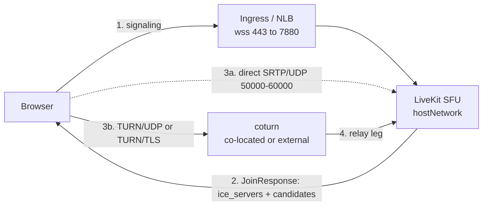

## Scenario matrix at a glance

| # | Topology | When to use it | TURN relay | Key setting |
|---|---|---|---|---|
| 1 | Public IP directly on the node, co-located coturn | The node has a public address on its interface | Public node IP | `use_external_ip: false`, `node_ip` |
| 2 | NAT-gateway EIP, co-located coturn | The node's egress is SNAT'ed to a NAT-gateway EIP and TURN runs on the node | Private node IP | `advertise_internal_ip: true`, `coturn.externalIP: ""` |
| 3 | EIP in NAT mode, external TURN behind 1:1 NAT | TURN must run off-node | Public TURN IP | `coturn.enabled: false`, `rtc.turn_servers` |
| 4 | Co-located coturn declaring a 1:1 mapping on a NAT-mode EIP | Do not use; documented failure | NAT-mode EIP | `coturn.externalIP: <node EIP>` |
| 5 | TURN/TLS over TCP and ICE/TCP | Restrictive client networks | Inherits 2 | `turns:` URL, `tcp_port` |

Decision rule:

- Public IP on the node: Scenario 1.
- NAT-gateway EIP with the SFU: Scenario 2.
- TURN must live off-node: Scenario 3.
- Co-located coturn advertising a NAT-mode EIP as its relay: avoid (Scenario 4).
- Clients block UDP: add Scenario 5.

## Scenario 1 — Public IP directly on the node, co-located coturn

### Topology

The node's public address is on its interface. There is no NAT between the SFU,
coturn, and the internet. Both direct and relay paths are public.

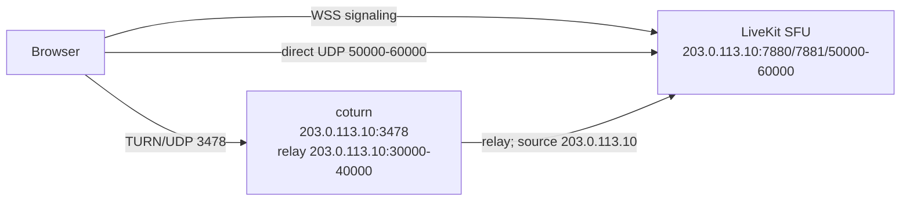

### Connection sequence

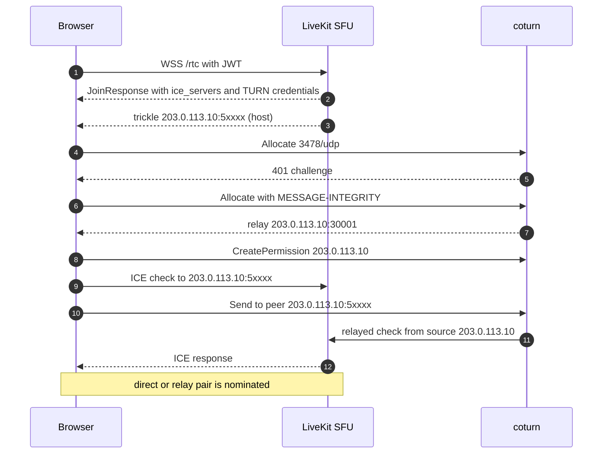

### Configuration

```yaml
livekit:
  port: 7880
  rtc:
    tcp_port: 7881
    port_range_start: 50000
    port_range_end: 60000
    use_external_ip: false
    node_ip: 203.0.113.10
    advertise_internal_ip: false
    turn_servers:
      - host: turn.example.com
        port: 3478
        protocol: udp
        secret: <turn-shared-secret>
        ttl: 14400
  turn:
    enabled: false
coturn:
  enabled: true
  secret: <turn-shared-secret>
  realm: livekit
  listeningPort: 3478
  relayPortStart: 30000
  relayPortEnd: 40000
  externalIP: ""
  tls:
    enabled: false
podHostNetwork: true
turnLoadbalancer:
  enable: false
```

`use_external_ip: false` plus `node_ip` is deterministic; `node_ip` is ignored
while `use_external_ip` is true, so the two settings go together. Setting
`use_external_ip: true` and dropping `node_ip` also works here because STUN
discovers the same address.

### Ports, security groups, and load balancers

| Purpose | Port/protocol | Where | Public path |
|---|---|---|---|
| Signaling | 7880/tcp | SFU | ingress or NLB 443 |
| ICE/TCP | 7881/tcp | node | direct |
| SFU media | 50000-60000/udp | node | direct |
| TURN listener | 3478/udp | coturn | direct or NLB |
| TURN relay | 30000-40000/udp | coturn | direct |

Security group inbound: TCP 7880, TCP 7881, UDP 50000-60000, UDP 3478, UDP
30000-40000. `lk.example.com` and `turn.example.com` point at the node address
or at an NLB that preserves those ports.

### Expected output from `test-livekit.py`

The following is illustrative; capture the literal lines from your own run.

```text
Phase 1: LiveKit signaling + discovery
   SFU advertised ICE candidates (from signaling):
     UDP 203.0.113.10:50001 (host)
Phase 2: STUN binding (server-reflexive address)
       reflexive : 192.0.2.10:53421   PASS
Phase 3: TURN relay over UDP
       allocate  : relay A 203.0.113.10:30001   relay B 203.0.113.10:30002   PASS
       relay data: token echoed via relay   PASS
Phase 4: TURN relay over TCP/TLS
   result         : SKIP  (no TCP/TLS TURN server advertised)
Phase 5: ICE connectivity checks (RFC 8445, relay-only)
       selected  : relay 203.0.113.10:30001  <->  relay 203.0.113.10:30002   PASS
```

No `address :` line is printed on a healthy run where SFU candidates were
received. Absence of that line is the pass signal.

### Symptom to cause to fix

| Symptom | Cause | Fix |
|---|---|---|
| Phase 2 FAIL | UDP 3478 blocked or coturn down | open the security group; check coturn logs |
| Phase 3 PASS but clients fail | relay range 30000-40000 blocked | open UDP 30000-40000 |
| Phase 1 has no candidate line | signaling or ingress problem | check the ingress and the WSS URL |
| Phase 4 SKIP | no `turns:` URL advertised | expected unless Scenario 5 is configured |

## Scenario 2 — Node behind a NAT-gateway EIP, co-located coturn, internal and external candidates

This is the recommended topology for a node whose egress address is a
NAT-gateway EIP.

### Topology

The node has a private address (`10.0.0.10`). Outbound traffic is SNAT'ed by a
NAT gateway to `203.0.113.10`; that address is not on the node, and there is no
inbound DNAT rule for the SFU media range. coturn relays on the private address.
LiveKit advertises both the STUN-discovered public candidate and the private SFU
candidate.

Direct connectivity can still succeed without DNAT through ICE hole punching:
the SFU is a full ICE agent, so its outbound checks are SNAT'ed and create a
stateful mapping; the client learns the mapped address as a peer-reflexive
(`prflx`) candidate and replies through the same mapping. This requires outbound
UDP, `use_ice_lite: false` (the default), and NATs that permit the inbound
checks; symmetric NATs, restrictive filtering, or a UDP-blocking firewall leave
TURN as the only path.

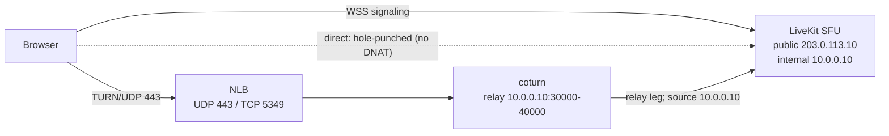

### Connection sequence

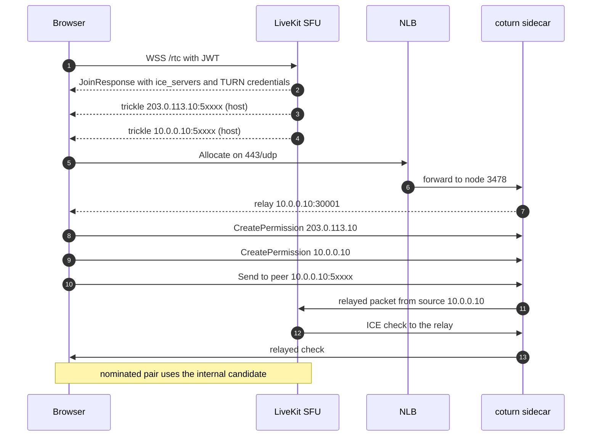

### Why no EIP hairpin is needed

The browser learns both SFU candidates and installs TURN permissions for both
peer addresses. coturn's relay is on `10.0.0.10`. The SFU's route to that relay
is local, so its source is `10.0.0.10`; that source matches the permission
created for the internal candidate.

The relay candidate handed to the browser is private, but the browser never
dials it directly. The browser sends through its allocation, and the TURN server
forwards to the peer. No packet needs to reach `203.0.113.10` from inside the
node, which is exactly what an EIP in NAT mode cannot do.

Without `advertise_internal_ip`, the browser permits only `203.0.113.10`; the
SFU's packets arrive from `10.0.0.10` and coturn drops them.

The direct path does not need hairpin either. The SFU sends its checks outbound
to the client's public address, and the NAT gateway SNATs them, creating a
stateful mapping. The client replies to the mapped address (`prflx`), and the
gateway forwards the reply back through that mapping. The advertised public
candidate port is the node's local port, not the translated port, so the
advertised candidate itself is usually unreachable; the `prflx` address is the
usable one.

### Configuration

```yaml
livekit:
  port: 7880
  rtc:
    tcp_port: 7881
    port_range_start: 50000
    port_range_end: 60000
    use_external_ip: true
    advertise_internal_ip: true
    # keep false so the SFU initiates checks for hole punching
    use_ice_lite: false
    turn_servers:
      - host: turn.example.com
        port: 443
        protocol: udp
        secret: <turn-shared-secret>
        ttl: 14400
      - host: turn.example.com
        port: 5349
        protocol: tls
        secret: <turn-shared-secret>
        ttl: 14400
  turn:
    enabled: false
coturn:
  enabled: true
  secret: <turn-shared-secret>
  realm: livekit
  listeningPort: 3478
  tlsPort: 5349
  relayPortStart: 30000
  relayPortEnd: 40000
  externalIP: ""
  tls:
    enabled: false
podHostNetwork: true
turnLoadbalancer:
  enable: false
```

`coturn.externalIP: ""` renders `--external-ip=$NODE_IP`, so the relay stays on
the node private address. `coturn.tls.enabled: false` is intentional: the NLB
terminates TLS and forwards plain TCP to node port 3478. Do not run LiveKit's
embedded TURN (`livekit.turn.enabled: false`) alongside coturn.

### Ports, security groups, and load balancers

| Purpose | Public | Backend | Protocol |
|---|---|---|---|
| TURN/UDP | `turn.example.com:443` | `10.0.0.10:3478` | UDP |
| TURN/TLS | `turn.example.com:5349` | `10.0.0.10:3478` (NLB terminates TLS) | TCP |
| TURN relay | none | `10.0.0.10:30000-40000` | UDP |
| Signaling | `lk.example.com:443` | ingress to 7880 | TCP |
| ICE/TCP | none (no DNAT) | `10.0.0.10:7881` | TCP |
| SFU media | hole-punched mapping | `10.0.0.10:50000-60000` | UDP |

The NAT gateway has no static mapping for the media range. UDP direct media
works only when the SFU's outbound checks create a stateful pinhole and the
client's NAT permits the inbound check. The advertised public port is the
node's local port, not the gateway's translated port; the actual port is the
`prflx` one seen in the selected pair. ICE/TCP has no equivalent hole-punching
path here: the passive candidate requires a real inbound mapping.

The relay range is node-local; peers reach it only through TURN, so it does not
need public exposure in this scenario. Keep it open on the node firewall for
coturn itself.

### Expected output from `test-livekit.py`

```text
Phase 1: LiveKit signaling + discovery
   SFU advertised ICE candidates (from signaling):
     UDP 203.0.113.10:50001 (host)
     UDP 10.0.0.10:50001 (host)
Phase 2: STUN binding (server-reflexive address)
       reflexive : 192.0.2.10:53421   PASS
Phase 3: TURN relay over UDP
       allocate  : relay A 10.0.0.10:30001   relay B 10.0.0.10:30002   PASS
       relay data: token echoed via relay   PASS
Phase 4: TURN relay over TCP/TLS
       allocate  : relay A 10.0.0.10:30003   relay B 10.0.0.10:30004   PASS
Phase 5: ICE connectivity checks (RFC 8445, relay-only)
       selected  : relay 10.0.0.10:30001  <->  relay 10.0.0.10:30002   PASS
Phase 6: Direct connectivity (no TURN)
   local          : host, srflx
   selected       : host 192.168.1.10:53421  <->  prflx 203.0.113.10:5yyyy
   result         : PASS
```

The `prflx` remote candidate and its port, which differs from the advertised
candidate, are the hole-punched mapping. On a symmetric or port-restricted
client NAT, Phase 6 can fail and Phase 7 selects relay.

No `address :` line is printed because the SFU advertises a private candidate
(`server_has_private` is true). Exit code 0.

When `advertise_internal_ip` is missing, the tester prints one of these after
the selected-pair line:

```text
       address   : TURN relay 10.0.0.10 is private, SFU only advertises 203.0.113.10   FAIL
```

or `WARN` when the client's reflexive address is public. `FAIL` makes the run
exit non-zero; `WARN` does not.

### Symptom to cause to fix

| Symptom | Cause | Fix |
|---|---|---|
| Phase 3/5 PASS, browser media fails | `advertise_internal_ip` is missing | set `livekit.rtc.advertise_internal_ip: true` |
| `address : ... FAIL` | private relay, public-only SFU, client behind SNAT | same fix as above |
| `address : ... WARN` | same, client has a public reflexive address | same fix; do not trust exit 0 |
| Only the public candidate appears | external IP discovery or self-ping failed | try `skip_external_ip_validation: true` or `node_ip` |
| Phase 4 SSL error | certificate mismatch | fix the cert; `--insecure-tls` is only for testing |
| Allocate 401/403 | coturn secret and `turn_servers[].secret` differ | make them equal |

## Scenario 3 — Node behind an EIP in NAT mode, external TURN server behind 1:1 NAT

Use this when TURN must run off the SFU node. The chart does not deploy this
TURN server; `coturn.enabled` stays false and LiveKit is pointed at the external
endpoint.

### Topology

The external TURN host has a public address (`198.51.100.10`) mapped 1:1 to its
private address (`172.16.0.10`). coturn advertises the public relay address. The
SFU's egress to that relay is SNAT'ed to its own public EIP (`203.0.113.10`).

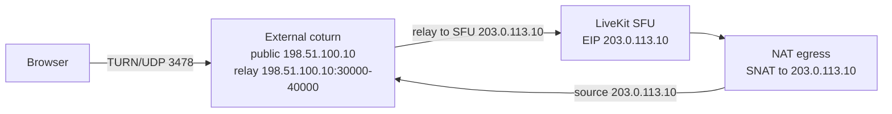

### Connection sequence

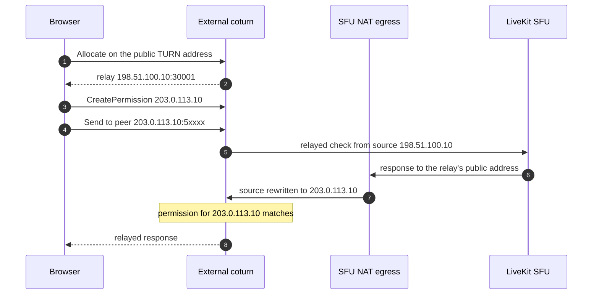

### Why the permission matches

The browser permits the SFU's advertised public IP, `203.0.113.10`. Because the
SFU and TURN server are on different hosts, the SFU's packets to the public
relay leave the node and are SNAT'ed to `203.0.113.10`. The source arriving at
coturn therefore matches the permission.

Permissions are keyed by IP, not by source port, so the ephemeral port used by
the SFU is irrelevant. If the SFU also advertises an internal candidate, the
browser will also permit `10.0.0.10`; that permission is useless to a TURN
server on another network but harmless as long as the public candidate remains
advertised.

### Configuration

Chart side:

```yaml
livekit:
  port: 7880
  rtc:
    tcp_port: 7881
    port_range_start: 50000
    port_range_end: 60000
    use_external_ip: true
    advertise_internal_ip: false
    turn_servers:
      - host: turn.example.com
        port: 3478
        protocol: udp
        secret: <turn-shared-secret>
        ttl: 14400
      - host: turn.example.com
        port: 5349
        protocol: tls
        secret: <turn-shared-secret>
        ttl: 14400
  turn:
    enabled: false
coturn:
  enabled: false
podHostNetwork: true
turnLoadbalancer:
  enable: false
```

External coturn service:

```bash
turnserver \
  --listening-port=3478 \
  --tls-listening-port=5349 \
  --relay-ip=172.16.0.10 \
  --external-ip=198.51.100.10/172.16.0.10 \
  --min-port=30000 --max-port=40000 \
  --use-auth-secret --static-auth-secret=<turn-shared-secret> \
  --realm=livekit \
  --cert=/etc/coturn/tls.crt --pkey=/etc/coturn/tls.key
```

### Ports, security groups, and load balancers

On the TURN host: UDP 3478, TCP 5349, UDP 30000-40000 inbound. The EIP must map
those ports 1:1 to the private address. On the SFU node: signaling 7880, ICE/TCP
7881, UDP 50000-60000 as in Scenario 2. The SFU needs outbound access to the
TURN host.

### Expected output from `test-livekit.py`

```text
Phase 1: LiveKit signaling + discovery
     TURN/UDP  turn:turn.example.com:3478?transport=udp
     TURN/TCP  turns:turn.example.com:5349?transport=tcp
   SFU advertised ICE candidates (from signaling):
     UDP 203.0.113.10:50001 (host)
Phase 3: TURN relay over UDP
       allocate  : relay A 198.51.100.10:30001   relay B 198.51.100.10:30002   PASS
Phase 5: ICE connectivity checks (RFC 8445, relay-only)
       selected  : relay 198.51.100.10:30001  <->  relay 198.51.100.10:30002   PASS
```

No `address :` line. The relay is public, so the address-mismatch check does not
fire.

Phases 3 and 5 do not exercise the SFU-to-TURN leg. Phase 7 adds relay
candidates to a real client-to-SFU connection, so it exercises that leg when a
relay pair succeeds; a run where direct wins does not prove the relay path. A
passing run plus the permission argument above is evidence, not proof; a
browser test is still the final check.

### Symptom to cause to fix

| Symptom | Cause | Fix |
|---|---|---|
| Allocate 401/403 | shared secret differs or TTL expired | equalize secrets; check clocks |
| Phase 3 relay PASS, SFU checks dropped | SFU egress is not SNAT'ed to its advertised IP | verify the node's outbound path and EIP |
| Relay allocated but no data | relay port range not reachable on the TURN EIP | open UDP 30000-40000 1:1 |
| Phase 4 TLS failure | certificate or port mapping | check 5349 and the cert SAN |

## Scenario 4 — Anti-pattern: co-located coturn advertising a public relay on a NAT-mode EIP

This configuration applies coturn's 1:1 NAT form
(`--external-ip=<public>/<private>`) to a node whose public address is an EIP in
NAT mode. It looks reasonable on paper and passes the connectivity tester, but
browsers cannot send media. It is documented so it can be recognized and
avoided.

### Topology

`coturn.externalIP: 203.0.113.10` renders `--external-ip=203.0.113.10/$NODE_IP`,
so coturn advertises `203.0.113.10` as the relay address and assumes the network
maps that address 1:1 to `$NODE_IP` with port preservation. A NAT-mode EIP does
not provide that mapping: the address lives on the cloud gateway, the relay
range `30000-40000` has no documented inbound mapping to the node, and the node
cannot hairpin to its own EIP. The SFU is on the same node and must send ICE
checks to the advertised address; those checks never reach coturn. Even when
hairpin works, coturn may see the SFU's private source (`10.0.0.10`), which the
browser never permitted.

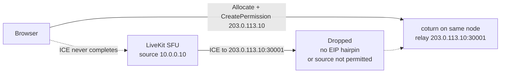

### Connection sequence

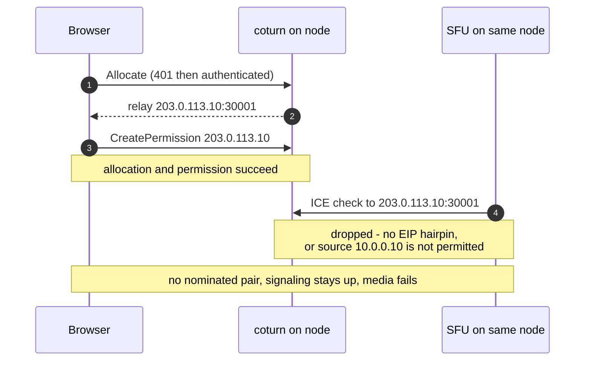

### Why it fails

The configuration declares a 1:1 mapping; the deployment does not provide one.
Two independent mechanisms follow:

1. **The declared mapping is absent.** The EIP is in NAT mode: it lives on the
   cloud gateway, not the node interface, and the relay range `30000-40000` has
   no port-preserving inbound path to `$NODE_IP`. coturn advertises
   `203.0.113.10` because `--external-ip` told it to, but packets sent to that
   address do not arrive at the relay. The node cannot hairpin to its own EIP,
   so the SFU's ICE checks are dropped.
2. **Permission source mismatch.** Even when a hairpin or DNAT rule is in
   place, coturn may observe the SFU's source as `10.0.0.10`. The browser
   permitted `203.0.113.10`, so coturn drops the check.

Either mechanism is sufficient to break media.

### Why relay-only testing does not catch it

The tester's Phase 3 and Phase 5 use two allocations on the same coturn. coturn
forwards allocation-to-allocation traffic locally, so relay-to-relay passes
without touching the EIP. Because the relay address is public,
`_relay_address_mismatch()` never fires; it requires a private relay plus
public-only SFU candidates. The run exits 0 on a deployment where browsers
cannot send media.

Phase 7 does offer TURN candidates to the SFU, so it attempts the SFU-to-relay
leg. But the same client also offers direct candidates, and direct connectivity
usually succeeds in this anti-pattern. Phase 7 therefore reports PASS with a
direct best-successful pair while the relay path is broken; it does not fail on
a failed relay pair when direct is available.

This is the most important warning in this document: **a green tester result is
not a browser test.**

### Configuration that produces it

```yaml
livekit:
  rtc:
    use_external_ip: true
    advertise_internal_ip: false
    turn_servers:
      - host: turn.example.com
        port: 443
        protocol: udp
        secret: <turn-shared-secret>
coturn:
  enabled: true
  secret: <turn-shared-secret>
  externalIP: 203.0.113.10
  relayPortStart: 30000
  relayPortEnd: 40000
  tls:
    enabled: false
podHostNetwork: true
```

Rendered coturn arguments:

```text
turnserver -c /etc/coturn/turnserver.conf \
  --relay-ip=$NODE_IP --external-ip=203.0.113.10/$NODE_IP
```

The `<public>/<private>` form is coturn's 1:1 NAT mode: coturn advertises the
public address and expects the network to preserve ports. It is correct only
when the public address is genuinely mapped 1:1 to `$NODE_IP` with port
preservation; a co-located coturn also needs hairpin for its own SFU to reach
the relay. The external TURN host in Scenario 3 satisfies the 1:1 requirement
because it is not co-located. Scenario 4's NAT-mode EIP satisfies neither.

### Expected output from `test-livekit.py`

```text
Phase 3: TURN relay over UDP
       allocate  : relay A 203.0.113.10:30001   relay B 203.0.113.10:30002   PASS
       relay data: token echoed via relay   PASS
Phase 5: ICE connectivity checks (RFC 8445, relay-only)
       selected  : relay 203.0.113.10:30001  <->  relay 203.0.113.10:30002   PASS
```

No `address :` line, exit code 0. Browser evidence is different: ICE reaches
`checking` and then `failed`; coturn logs show an allocation but no peer traffic;
the node has no flow to its own EIP.

### Symptom to cause to fix

| Symptom | Cause | Fix |
|---|---|---|
| Tester PASS, browser media fails | public relay on a co-located coturn | `coturn.externalIP: ""` plus `advertise_internal_ip: true` |
| Works on another cloud, fails on this one | that cloud supports EIP hairpin | do not depend on hairpin |
| Works from the node, fails from clients | node-local test bypasses the gateway | test from an external browser |

## Scenario 5 — TURN/TLS over TCP and ICE/TCP fallback

This scenario adds TCP-based paths for clients that cannot send UDP. It is not
a separate NAT topology; it layers onto Scenario 2 (or Scenario 3).

### Topology

There are two ways to serve TURN/TLS, plus a separate ICE/TCP path.

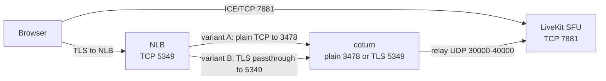

### Connection sequence

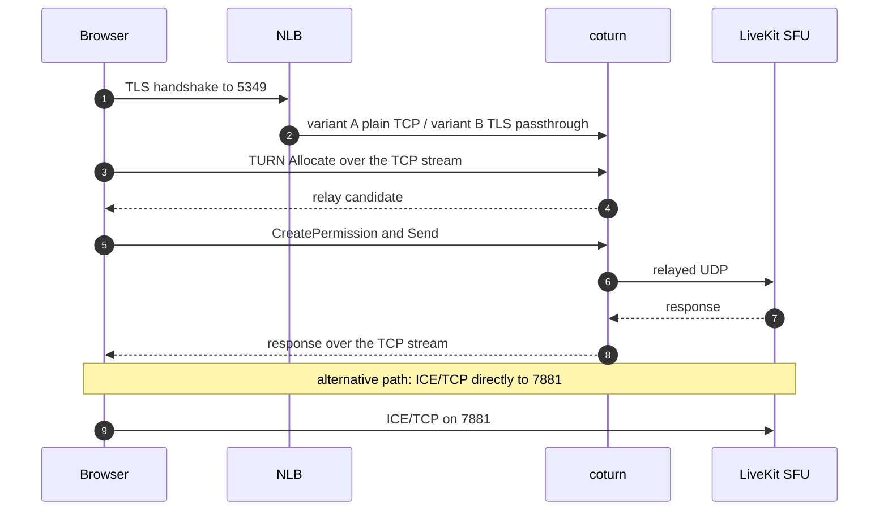

### Configuration — TLS terminated at the NLB

```yaml
coturn:
  enabled: true
  listeningPort: 3478
  tls:
    enabled: false
livekit:
  rtc:
    tcp_port: 7881
    turn_servers:
      - host: turn.example.com
        port: 5349
        protocol: tls
        secret: <turn-shared-secret>
```

`coturn.tls.enabled: false` makes the coturn config emit `no-tls` and `no-dtls`.
coturn serves plain TCP on 3478. The NLB holds the certificate and forwards
plain TCP to node 3478.

### Configuration — TLS terminated by coturn

```yaml
coturn:
  enabled: true
  tlsPort: 5349
  tls:
    enabled: true
  tlsSecretName: <tls-secret>
livekit:
  rtc:
    tcp_port: 7881
    turn_servers:
      - host: turn.example.com
        port: 5349
        protocol: tls
        secret: <turn-shared-secret>
```

The NLB is TCP passthrough to node 5349. Clients still dial the public port
(5349 in this example), not 5349 directly.

With `coturn.tls.enabled: true`, `coturn.tlsSecretName` falls back to
`livekit.turn.secretName` when empty. If both are empty, the rendered volume is
invalid.

### Ports, security groups, and load balancers

| Purpose | Port/protocol | Where | Public path |
|---|---|---|---|
| TURN/TLS (NLB termination) | 5349/tcp | NLB | public |
| TURN backend | 3478/tcp | coturn | NLB target |
| TURN/TLS (coturn termination) | 5349/tcp | coturn | NLB passthrough target |
| ICE/TCP | 7881/tcp | SFU | NLB listener or DNAT required behind NAT |
| TURN relay | 30000-40000/udp | coturn | as in the base scenario |

If TURN/UDP is also enabled, keep its listener and relay rules from Scenario 2.

### Expected output from `test-livekit.py`

```text
Phase 1: LiveKit signaling + discovery
     TURN/UDP  turn:turn.example.com:443?transport=udp
     TURN/TCP  turns:turn.example.com:5349?transport=tcp
Phase 4: TURN relay over TCP/TLS
       allocate  : relay A 10.0.0.10:30003   relay B 10.0.0.10:30004   PASS
       relay data: token echoed via relay   PASS
Phase 5: ICE connectivity checks (RFC 8445, relay-only)
       selected  : relay 10.0.0.10:30003  <->  relay 10.0.0.10:30004   PASS
```

With a self-signed certificate, Phase 4 fails with `ssl.SSLError` unless
`--insecure-tls` is passed. ICE/TCP on 7881 is not tested by the script; verify
it separately with a browser or a real call.

### Symptom to cause to fix

| Symptom | Cause | Fix |
|---|---|---|
| Phase 4 timeout | discovered URL lacks `transport=tcp` | check the `turns:` URL form and the NLB target |
| Phase 4 SSL error | certificate SAN or trust | fix the cert; use `--insecure-tls` only for testing |
| TLS handshake fails | NLB passthrough points at 3478 instead of 5349 | correct the target port |
| ICE/TCP fails | TCP 7881 blocked | open the security group and any NLB listener |

## Configuration matrix

### Helm values

| Scenario | `use_external_ip` | `advertise_internal_ip` | `coturn.enabled` | `coturn.externalIP` | `coturn.tls.enabled` | `rtc.turn_servers` | `turnLoadbalancer.enable` |
|---|---|---|---|---|---|---|---|
| 1 | false | false | true | `""` | false | udp 3478 | false |
| 2 | true | **true** | true | `""` | false | udp 443, tls 5349 | false |
| 3 | true | false | false | n/a | n/a | udp 3478, tls 5349 | false |
| 4 | true | false | true | node EIP | false | udp 443 | false |
| 5 | inherits 2 | inherits 2 | true | `""` | false (A) / true (B) | udp 443, tls 5349 | false |

### Infrastructure

| Scenario | Public address model | NLB listeners | Security-group inbound | Notes |
|---|---|---|---|---|
| 1 | Public IP on the node | optional | 7880/tcp, 7881/tcp, 50000-60000/udp, 3478/udp, 30000-40000/udp | no NAT |
| 2 | NAT-gateway EIP (SNAT/PAT) | UDP 443 to 3478, TCP 5349 to 3478 | 443/udp or 3478/udp, 5349/tcp; media has no inbound mapping | relay stays private; direct via hole punching |
| 3 | SFU EIP plus TURN EIP | optional on the TURN host | 3478/udp, 5349/tcp, 30000-40000/udp on the TURN host | TURN off-node |
| 4 | EIP in NAT mode | UDP 443 to 3478 | same as Scenario 2 | do not use |
| 5 | inherits 2 or 3 | adds TCP 5349 | adds TCP 5349, 5349, 7881/tcp | UDP-restricted clients |

## Why TURN permissions matter

A TURN permission is a rule for a **peer IP address**. The browser calls
`CreatePermission` for each remote candidate address the SFU advertised. The
TURN server then accepts traffic from those source IPs and drops everything
else, regardless of source port.

The invariant:

> **The SFU's source IP as seen by the TURN server must be one of the peer IPs
> the SFU advertised to the browser.**

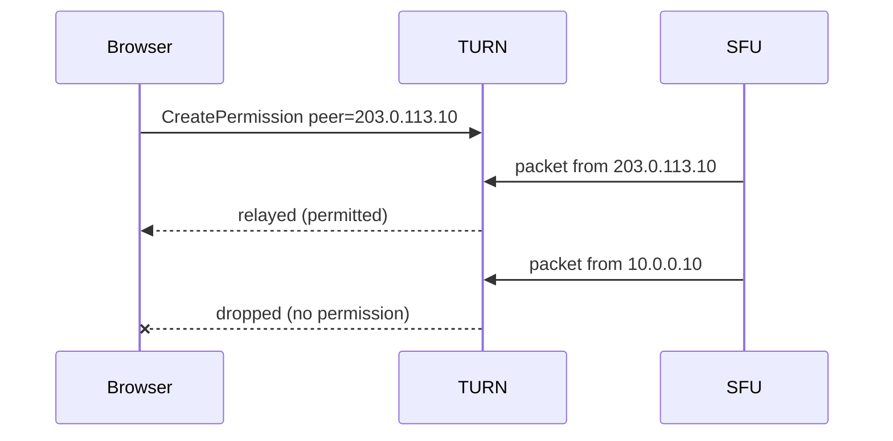

The tester's address check reflects this invariant:

- `FAIL` when TURN hands out a private relay while the SFU advertises only
  public candidates, **and** the client's own reflexive address is private
  (a sign of SNAT on the client path). The run exits non-zero.
- `WARN` for the same address pattern when the client's reflexive address is
  public. The run exits 0; the warning still means relay-only clients can fail.
- No `address :` line when the SFU advertises a private candidate or when no
  SFU candidates were observed.

`WARN` does not change the exit code, so a green run is not proof that every
client path works.

## Port and firewall matrix

| Purpose | Port/protocol | Lives on | Public exposure |
|---|---|---|---|
| Signaling (WSS) | 7880/tcp | SFU | ingress or NLB 443 |
| ICE/TCP | 7881/tcp | SFU node | Scenario 1 direct; behind NAT requires a DNAT/NLB mapping |
| SFU media | 50000-60000/udp | SFU node | Scenario 1 direct; Scenario 2 hole-punched or relay |
| TURN listener | 3478/udp and 3478/tcp | coturn | NLB UDP 443, TCP 5349 |
| TURN/TLS | 5349/tcp | coturn | NLB TCP 5349 (passthrough) |
| TURN relay | 30000-40000/udp | coturn | only when a public relay is configured |

`podHostNetwork: true` plus fixed ports means one LiveKit pod per node. The
coturn relay range must not overlap the SFU media range.

## Verifying a deployment with run-test-livekit.sh

Run from `livekit-server/chart/scripts`:

```bash
ENV_FILE=/secure/livekit.env ./run-test-livekit.sh --timeout 8 -v
ENV_FILE=/secure/livekit.env ./run-test-livekit.sh --insecure-tls
```

The env file is sourced with `set -a`. It must define `LIVEKIT_URL`,
`LIVEKIT_API_KEY`, and `LIVEKIT_API_SECRET`. Never commit the env file.

`run-test-livekit.sh` also installs the optional Phase 8 tooling: the Python
`playwright` package and the pinned `livekit-client` browser bundle. It uses the
installed Google Chrome (`channel="chrome"`), so it does not download a browser.
If Playwright, Chrome, or the bundle is unavailable, Phase 8 reports `SKIP`; the
rest of the suite still runs.

Flags:

| Flag | Meaning |
|---|---|
| `--url`, `--api-key`, `--api-secret` | override the environment variables |
| `--room`, `--identity` | room and participant identity |
| `--protocol` | LiveKit signal protocol version (default 15) |
| `--timeout` | per-operation timeout in seconds (default 5; ICE has higher floors) |
| `--insecure-tls` | skip certificate verification for TURN/TLS |
| `-v` | print TURN credential details and aioice logs |

`--protocol` applies to the raw-protocol phases. Phase 8 lets the browser SDK
use its own protocol; it is not affected by `--protocol`.

Phase interpretation:

| Phase | Proves | Does not prove |
|---|---|---|
| 1 signaling + discovery | WSS works; TURN servers and SFU candidates are advertised | media connectivity |
| 2 STUN binding | UDP reaches the TURN host; shows the client reflexive address | TURN authentication |
| 3 TURN relay UDP | authenticated allocation, permission, and data relay | the SFU-to-TURN leg |
| 4 TURN relay TCP/TLS | the same over the TLS stream | ICE/TCP on 7881 |
| 5 ICE relay-only | a real ICE agent completes relay-to-relay and nominates a pair | browser media, direct ICE, SFU source matching |
| 6 direct connectivity | a real WebRTC client completes ICE and DTLS with the SFU without configuring TURN | media flow; a browser's path choice |
| 7 path selection | one real WebRTC client offers host, srflx, and relay candidates and reports the nominated and highest-priority successful pairs | media flow; a browser's independent choice (nomination follows the controlling ICE role); relay-only selection when direct is also available |
| 8 browser path | a real Chrome/livekit-client browser joins, publishes a synthetic track, and reports the selected pair and ICE role for every browser PeerConnection | relay-only behavior (the test does not force `iceTransportPolicy: "relay"`); that the selected path is optimal |

Phases 6 and 7 use `aiortc` to answer the SFU's subscriber offer as a real
WebRTC client. `run-test-livekit.sh` installs it; if it is missing, both phases
report `SKIP`. Phase 6 configures STUN only. Phase 7 configures STUN plus every
advertised TURN endpoint with its short-lived credentials. When the deployment
advertises no `stun:` URL, both use the TURN host for a STUN Binding only;
Phase 6 never allocates a relay.

The SFU sends the subscriber offer, so it is the controlling ICE agent unless
ICE-lite is negotiated. With the chart default (`use_ice_lite: false`) the SFU
controls and nominates; the test client is controlled. If the SFU is ICE-lite,
the roles reverse and the client controls. LiveKit can also force full ICE for
clients that do not support ICE-lite, such as Firefox without
peer-reflexive-over-relay.

Phase 8 is the browser check. It drives the installed Chrome through Playwright
and the official `livekit-client` SDK, joins the room, publishes a synthetic
canvas track, and reports the selected pair and ICE role for every
PeerConnection the browser created. The SDK's default single-PeerConnection
mode is used, so the test behaves as a current web client; if the SDK creates
two connections, both are reported. The phase has no network-location mode: it
prints the path it observed (direct or relay), the candidate types and
addresses, and whether a private address was used. A relay path or a private
address is a fact, not a failure.

```text
Phase 6: Direct connectivity (no TURN)
   local          : host, srflx
   selected       : srflx 192.0.2.10:53421  <->  host 203.0.113.10:50001
   result         : PASS
Phase 7: Path selection (direct vs TURN)
   local          : host, relay, srflx
   role           : SFU controlling (client controlled)
   nominated      : relay 10.0.0.10:30001  <->  host 10.0.0.10:50001   (relay)
   best successful: srflx 192.0.2.10:53421  <->  host 203.0.113.10:50001   (direct)
   note           : the controlling agent nominates; a relay pair can win before a
                    higher-priority direct pair completes.
   result         : PASS
Phase 8: Browser path (Chrome + livekit-client)
   client         : Chrome 155.0.8059.85 / livekit-client 2.23.0 (local)
   signaling      : wss://lk.example.com/rtc/v1 (join_request)
   peer connection: 1 (publisher+subscriber)
   gathered       : host, relay, srflx
   single         : direct  local srflx 192.0.2.10:53421  remote prflx <hidden>:35519  role=client/controlling
                    pair state=succeeded nominated=True ice=connected dtls=connected
                    inferred       : remote prflx 203.0.113.10 (from the SFU's public candidates; port 35519)
   private addr   : none
   result         : PASS
```

Chrome may redact the address of a remote peer-reflexive candidate and of
local host candidates (`<hidden>`); the type and port are still reported. When
the remote `prflx` address is hidden, Phase 8 prints an `inferred` line with the
SFU's public candidate address(es) discovered in Phase 1. It is an inference,
not a browser-reported value, and the port is the browser-reported port. The
`gathered` line is a snapshot taken after the selected pair and a short settle,
so a relay allocation that completes later may not appear.

Exit codes:

| Code | Meaning |
|---|---|
| 0 | every attempted phase passed; SKIP and WARN do not fail |
| 1 | at least one attempted phase failed |
| 2 | missing required configuration |
| 3 | missing Python dependency |

Reading rules:

- `SKIP` means the deployment does not advertise that transport, or the
  optional dependency for that phase is missing. It is not a pass.
- Absence of an `address :` line means no mismatch was detected. It does not by
  itself prove the SFU-to-TURN leg; Phase 7 exercises that leg only when a relay
  pair succeeds.
- `WARN` is a latent browser failure; do not treat exit 0 as complete proof.
- In Phase 7, `nominated` is the pair the controlling agent selected. With full
  ICE the SFU sends the subscriber offer and controls; with ICE-lite the client
  controls. `best successful` is the client's highest-priority successful pair
  after a one-second settle following connection, so checks that finish just
  after connect are included. It is not necessarily the nominated pair, and is
  printed only when it differs. The tested LiveKit build does not enable Pion's renomination, so a
  relay nomination is not replaced by a later direct success.
- For relay-only assurance, run a browser with `iceTransportPolicy: "relay"`
  and confirm ICE reaches `connected`. Phase 7 offers relay candidates but also
  direct ones; a direct best-successful pair does not prove the relay path.
- In Phase 8, `single`, `publisher`, and `subscriber` label the PeerConnection
  or connections the browser created. `role=client/controlling` means the
  browser nominated; `role=SFU/controlled` means the SFU did. `direct`/`relay`,
  the candidate types and addresses, and `private addr` are observations; a
  relay path or a private address does not fail the phase. Only a missing
  succeeded pair, a disconnected PeerConnection, or an unreadable ICE role
  fails it.
- When Chrome hides the remote `prflx` address, the `inferred` line lists the
  SFU's public candidate address(es) discovered in Phase 1. Treat it as an
  inference; the visible port is the browser-reported port. If no public SFU
  address was discovered, the line is omitted.
- Phase 8 uses the SDK's default single-PeerConnection mode, so it reflects a
  current browser client. It has no network-location mode or expected-path
  switch; run it wherever the browser runs. `SKIP` means Playwright, Chrome,
  or the pinned `livekit-client` bundle is unavailable, not a deployment
  failure.
- A direct browser selection does not prove the relay path, and a relay
  selection does not prove the direct path. Phase 8 reports the default-policy
  choice; relay-only assurance still needs a browser run with
  `iceTransportPolicy: "relay"`.

## Cross-scenario symptom to cause to fix

| Symptom | Likely cause | Fix |
|---|---|---|
| Phase 1 fails | DNS, ingress certificate, wrong URL, bad API key | check `lk.example.com`, ingress, and credentials |
| Phase 1 shows only the public candidate | external IP discovery or self-ping failed | set `skip_external_ip_validation: true` or `node_ip` |
| Phase 1 shows no candidate line | signaling completed but no trickle arrived | check the server version and the candidate collection window |
| Phase 2 FAIL | UDP to the TURN host blocked, or coturn down | check NLB listener, security group, coturn logs |
| Allocate 401/403 | `coturn.secret` and `rtc.turn_servers[].secret` differ | make them identical |
| Phase 3/4 PASS, browser media fails | co-located coturn advertising a NAT-mode EIP as a relay (Scenario 4) | `coturn.externalIP: ""` plus `advertise_internal_ip: true`, or move TURN off-node |
| `address : ... FAIL` | private relay, public-only SFU, client behind SNAT | advertise the internal candidate |
| `address : ... WARN` | same pattern, public client | same fix; do not ignore |
| Phase 3 relay allocated, no data | relay range blocked or not mapped | open UDP 30000-40000 end to end |
| Phase 4 SSL error | self-signed or wrong certificate | fix the certificate; use `--insecure-tls` only for testing |
| Phase 4 timeout | discovered URL lacks `transport=tcp` | check the URL form and the NLB target |
| ICE/TCP fails | TCP 7881 blocked | open TCP 7881 |
| Tester PASS, relay-only browser fails | SFU source IP does not match the permitted candidate | align advertised and source addresses |
| Works from the node, fails from clients | node-local test bypasses the cloud gateway | test from an external browser |

## Aliyun notes

These notes apply to Aliyun EIPs and NLBs but the reasoning generalizes to other
clouds with the same behavior.

- **EIP in NAT mode.** The EIP lives on the public gateway, not on the ECS
  interface. The instance sees only its private IP. Do not depend on the node
  reaching its own EIP; EIP hairpin is not a reliable building block.
- **Hole punching.** With a NAT-gateway EIP and no inbound DNAT, direct media
  can still work when the SFU initiates connectivity checks and the NATs permit
  the mapping. The usable remote address is the `prflx` one, not the advertised
  candidate. Do not treat a passing direct test as proof for every client
  network; symmetric or port-restricted NATs still need TURN.
- **NLB source-IP preservation.** Whether the TURN server sees the client's
  public address or a private SNAT address depends on the NLB server-group
  backend type and the client-IP-preservation setting. This changes the
  `reflexive` line, and it is used by the tester to choose `FAIL` versus `WARN`;
  it does not change the SFU-to-TURN permission logic.
- **EIP binding.** Confirm whether the SFU's advertised address is an EIP bound
  to the ECS/ENI or an NLB address. If it is an NLB address, use NLB listeners
  for the ports; if it is a node EIP, map the ports 1:1 and use security groups.
- **Security groups.** Open only the documented ranges. Keep the coturn relay
  range separate from the SFU media range.
- **One pod per node.** `hostNetwork` and fixed ports prevent two LiveKit pods
  on one node. Plan rolling updates and autoscaling accordingly.
- **Relay port range.** coturn uses `relayPortStart`/`relayPortEnd` (default
  30000-40000). The SFU media range (50000-60000) is unrelated; do not reuse it
  for coturn.

## Open questions, known inconsistencies, and risks

1. Phases 3 and 5 do not observe the SFU-to-TURN leg. Phase 7 attempts it, but
   it does not fail a run when the relay path is broken and a direct pair wins.
   Phase 8 reports the default-policy browser path, so it shows whether the
   browser needed TURN, but it does not force relay-only. Scenario 4 can still
   pass all phases and exit 0 while relay-only browsers fail; a browser run
   with `iceTransportPolicy: "relay"` remains necessary.
2. `WARN` does not fail the run. A green exit code can still mean relay-only
   clients fail.
3. `coturn.tls.enabled` defaults to `true` in the chart, but set it to `false`
   when the NLB terminates TLS. Copying the chart default without an NLB
   passthrough will break TURN/TLS.
4. With `coturn.tls.enabled: true`, `coturn.tlsSecretName` falls back to
   `livekit.turn.secretName` without a required check. If both are empty, the
   rendered volume is invalid.
5. `advertise_internal_ip` requires `use_external_ip: true`.
6. Advertising internal candidates alongside an external TURN server can create
   permissions that the TURN server cannot use. Keep the public candidate
   advertised, or disable internal advertisement for that topology.
7. Some coturn builds restrict private peer addresses. Scenario 2 relies on
   relay traffic to `10.0.0.10`; if the build denies RFC 1918 peers, the relay
   leg will fail. Verify on the deployed coturn version.
8. Long calls depend on NLB idle timeouts and TURN allocation refresh. The
   credentials use `ttl: 14400` in the examples; tune for the deployment.
9. IPv6 is not covered by these scenarios or by the tester.
10. Line numbers in chart files drift. Use value paths in reviews rather than
    line references.

## Source files

- `livekit-server/chart/values.yaml`
- `livekit-server/chart/templates/deployment.yaml`
- `livekit-server/chart/templates/coturn-configmap.yaml`
- `livekit-server/chart/config-sample.yaml`
- `livekit-server/chart/scripts/test-livekit.py`
- `livekit-server/chart/scripts/run-test-livekit.sh`
- `livekit-server/chart/scripts/test_direct_connect.py`
- `livekit-server/chart/scripts/test_browser_phase.py`
- `livekit-server/chart/scripts/browser/` (page and pinned `livekit-client` bundle)
